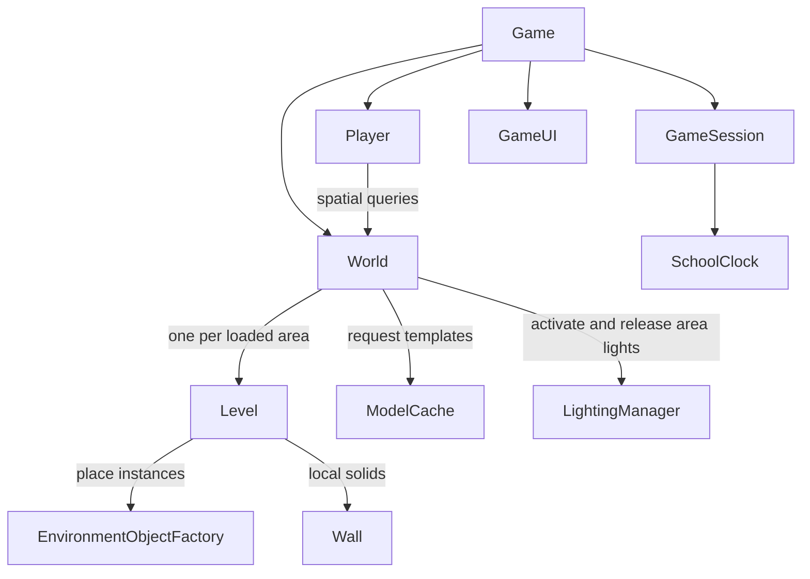
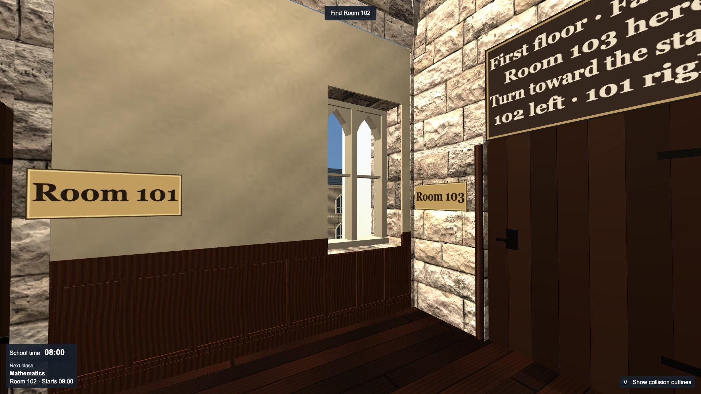
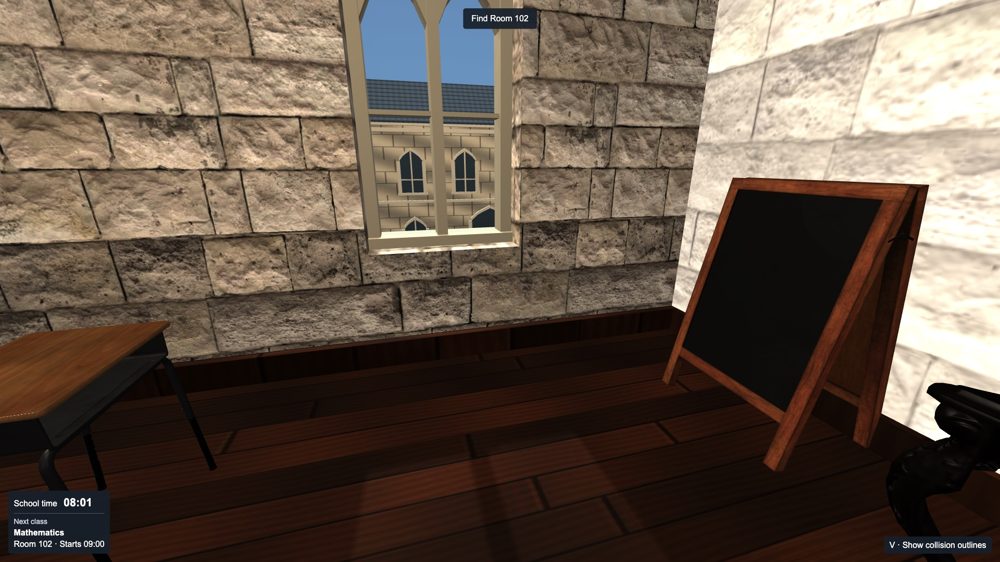

# Milestone 19.5 architecture decision

**Decision approved and implemented.** Each selectable level is a school with one active area. Two adjoining test areas exercise independent loading, collision, lighting and cleanup. The product owner approved physical adjacency as the foundation for milestone 20.

## Audit of the milestone 19 implementation

| Path | Current behavior and lifetime |
| --- | --- |
| Startup and retry | `main.js` creates the UI and catches startup errors. `Game.init` selects a JSON level, constructs one session and one Level, and waits for models before creating the renderer. `Game.restart` synchronously rebuilds that Level and all lighting, resets the player and session, synchronizes play access, and renders. Initial load failure leaves Start disabled. |
| Geometry and arrival | `Level.build` turns platforms and wall openings into axis-aligned solids, builds wireframes and surfaces, places furniture, creates door panels and their moving collision sections, and draws signs onto canvas textures. Room bounds come from JSON. Arrival checks the full player body and an open entrance where the room has doors. Hallway uses a separate proximity-and-E interaction and implicit floor and ceiling. Its pillars are visual. |
| Physics and time | Player already calls only three spatial methods. Wall supplies footprint and body intersection. Game checks the deadline before updating Player and sends the resulting room ID to GameSession. GameSession and SchoolClock have no scene dependency. GameUI and controls handle presentation and input settings. |
| Assets | EnvironmentObjectFactory resolves catalog defaults and variants, fetches each distinct path once per load call, parses with r128 GLTFLoader, and grounds the template. Clones borrow its geometry, materials and textures. Procedural parts reuse geometry and materials within one build. Level also borrows finish materials from templates. Separate load calls have separate caches. A rejected batch has no explicit cleanup for successful siblings. |
| Cleanup and lighting | Level removes its tracked scene objects, skips borrowed model groups and disposes unique generated geometry, materials and sign textures. Rebuild keeps the model map. LightingManager owns one list of lights, targets, shadows and fixtures. Calling its build clears the entire list and resets the renderer's shadow switch. There is no explicit final release of the complete model cache. |

Source paths for the audit include [Game](../js/Game.js), [Level](../js/Level.js), [EnvironmentObjectFactory](../js/EnvironmentObjectFactory.js), [LightingManager](../js/LightingManager.js), [Player](../js/Player.js) and [GameSession](../js/GameSession.js).

## Implemented ownership

- **Game** keeps the scene, renderer, browser events, frame loop and explicit challenge retry. **World** holds the area definitions, active set, logical door state and shared asset cache for the selected school. It answers spatial queries and delegates construction and lighting. It has no reference to the session or player.
- **Level** remains the one area builder and local query implementation. Each loaded entry owns a Level, its render objects, colliders, signs, door poses and a lighting registration. **EnvironmentObjectFactory** keeps placement, orientation corrections, named variants, procedural parts and fitted bounds. **ModelCache** takes over the existing fetch/parse path and template lifetime.
- **LightingManager** keeps the renderer-wide shadow policy and creates each light and fixture as today. Register global illumination once. For the school this is the hemisphere fill. Room 003's directional shadow light, courtyard and window lights, lanterns, fixtures and their targets belong to their area. Wireframe levels use the existing default light pair once. Enabling V updates all active registrations and newly activated areas inherit that view. Releasing an area disposes its shadows and fixtures and recomputes shadow enablement from the surviving lights.
- **Player, Wall, GameSession, SchoolClock, GameUI and controls** can keep their implementations. Game supplies World wherever Player currently receives Level. Session reset remains an explicit Game action.

## Data and spatial contract

Adapt each existing JSON level in memory to one area named `level-<numeric id>`. The level picker, URLs, level files, catalog paths and schedule remain valid. The registry treats authored definitions as read-only and holds them alongside room IDs and optional neighbor IDs even when no meshes exist. Preserve room strings including leading zeroes. Within one school, reject duplicate area or room IDs. For current doors, derive the local key from the unique room ID. Allow explicit door IDs for future rooms with multiple entrances. Qualify local object keys by area and kind. Use explicit IDs for new authored objects, legacy unique names where available, and deterministic part keys for generated pieces (for example, a door key plus its arch band number). Reject ambiguous authored keys. Keep mutable collider array slots private to Level.

For ordinary adjoining areas, author coordinates directly in one world-up-Y frame. Each shared wall, doorway and threshold has one authoring owner. Both active areas participate in queries regardless of which side contains the player's center. The fixture crosses a walkable seam and checks contact from both sides. Hallway's implicit floor and ceiling use its rectangular footprint. Author each classroom's arrival bounds and entrance door definitions in the same area so the existing local entrance check can resolve them.

| World query | Rule across active areas |
| --- | --- |
| `isBlocked`, `getStepHeight` | Any obstruction blocks. Compare the highest overlapping obstruction across all candidates before applying the step limit. Preserve Player's existing headroom and final body-clearance checks. A low tread beside a high wall must still block. |
| `getVerticalCollision` | Return the first crossed face in the direction of travel. For stationary support use the existing contact tolerance. Missing contact stays null. |
| Door interaction and room entry | Choose the nearest eligible closed door across active areas with a stable ID tie-break. Use the same candidate for the prompt and opening. Keep existing local room containment and entrance checks and the Hallway interaction. Reject ambiguous overlapping arrival regions in the fixture. Only GameSession decides what reaching a room means. |

## Lifecycle and failure rules

1. **Unloaded → loading.** `loadArea(id)` shares one pending operation per area. The cache shares one pending fetch and parse per resolved model URL across areas, including different catalog aliases and mesh variants. Keep the request timeout with the shared request. Unloading a waiter cannot abort another area's request.
2. **Loading → loaded.** Prepare the Level off-scene. Publish only after its dependencies and construction succeed. A failed build disposes its partial local objects. A failed cache entry is removed so a retry can fetch again. Successful sibling templates remain owned by the cache. Unload during a pending load invalidates that attempt so a late completion cannot reattach stale objects.
3. **Loaded → active.** `activateArea(id)` attaches its objects and lighting and enables its queries together. If activation fails, roll back that registration. Several areas can be active. Deactivation removes participation but can retain the loaded instance.
4. **Unload and reload.** `unloadArea(id)` removes participation first, then releases area-owned resources once. Repeated unload is harmless. Record opened doors by stable ID and swing direction when interaction succeeds. Reapply the same pose, debug outline and colliders on reload. A Boolean alone loses the side-dependent swing.
5. **Retry and teardown.** Retry invalidates pending area work, clears run-specific door state and restores the original active set, spawn and time. Keep the current single-area retry synchronous using cached assets so pointer-lock acquisition still occurs inside the Start click. At world teardown, release area instances before disposing cached template geometries, materials and textures once by identity, including textures in non-color slots. Late loader completions after teardown must release their assets.

The cache retains successfully loaded templates for the selected world's lifetime. This keeps retries and unload/reload cycles predictable. Memory therefore tracks the distinct models visited during that lifetime. Consider eviction when measurements on a larger school justify it. A second Area builder would duplicate Level's tested logic. Per-area GLB caches would duplicate the largest resources.

## Compatibility and limits

The implementation preserves the three existing level definitions, their model catalog and r128 loader. The adapter and registry live in [SchoolDefinition.js](../js/SchoolDefinition.js). [World](../js/World.js) asks the [cache](../js/ModelCache.js) to prepare a definition, builds Level off-scene, then attaches its objects and registers lighting on activation. Definitions and room identities outlive every activation. Current levels use stable names for legacy objects, with position as a fallback for unnamed geometry. Explicit IDs are preferable for future objects that may move or be renamed.

The world retains all successful template loads until teardown. Activation and spatial queries scan the small active set. Automatic neighbor selection, cache eviction and traversal between production areas remain future decisions.

## Verification

All **108 Node tests** and **83 Chrome tests** passed, including the original 100 and 76 respectively. The fixture loaded A and B concurrently, rendered B after removing A, reloaded A twice and verified template identity and disposal events. It exercised failed preparation, construction and lighting registration, both door swings, inactive and unloaded colliders, a boundary step beside a taller obstruction, and disposal during a pending GLB parse. An assembled Game test kept the Room 102 objective, pointer lock and advancing school time through area activation and reload. [Fixture](../tests/movement/test-world.js) · [Test instructions](../tests/README.md)

### Browser comparison

Chrome 158, ANGLE Metal on Apple M5 Pro, 1920 × 1080 at device pixel ratio 1. The before run used the milestone-19 runtime at `56414a2`. Both versions used cold browser caches, 25 Mbit/s and 40 ms latency for startup, then the same unthrottled, timed route through Rooms 003 and 101 to Room 102. Each column summarizes three runs. [Published milestone-19 results](courtyard-window-review.md#verification-and-performance)

| Metric | Published milestone 19 | Fresh before | After | Approved limit |
| --- | ---: | ---: | ---: | ---: |
| Uncached startup resource bodies | 16,754,036 B | 16,754,036 B | **16,768,600 B** | 16,777,216 B |
| Median time to enabled Start Game | 5.92 s | 5.929 s | 5.946 s | 7 s |
| Route p95 frame intervals | 8.9 / 9.2 / 9.3 ms | 9.1 / 9.2 / 9.2 ms | 9.1 / 9.2 / 9.2 ms | 16.7 ms per run |
| Estimated decoded texture and geometry storage | 238.1 MiB | 238.1 MiB | 238.1 MiB | 256 MiB |

Startup grew by **14,564 bytes**, leaving **8,616 bytes** under the limit. GLBs accounted for 15,938,420 bytes in both builds. Median startup was 17 ms slower in this comparison. Median frame interval was 8.3 ms in each of the six runs. The memory estimate counts unique geometry buffers and decoded texture levels in the scene.

Hallway started, moved and paused. In Physics Playground the player walked, turned, jumped, landed and restarted. All three school runs opened doors, climbed the public stairs, visited Room 101 while the clock ran, and finished on entering Room 102. A short-clock run paused across the deadline, resumed, timed out and retried with the starting time and closed doors. Rays through both windows reached the courtyard. Switching the daylight lights off affected the same numbers of pixels before and after. V displayed both glazing colliders.

### First-person screenshots

| View | Milestone 19 | Milestone 19.5 |
| --- | --- | --- |
| Vaulted corridor approaching the courtyard window |  |  |
| Daylight inside Room 101 |  |  |

The comparison used the original 1920 × 1080 lossless screenshots at eight fixed camera positions or view settings. Six pairs matched pixel for pixel, including Room 101 daylight, both views into the quadrangle and the collision view. The corridor approach and corridor daylight pairs each differed at one pixel out of 2,073,600. The JPEGs above are review copies.
