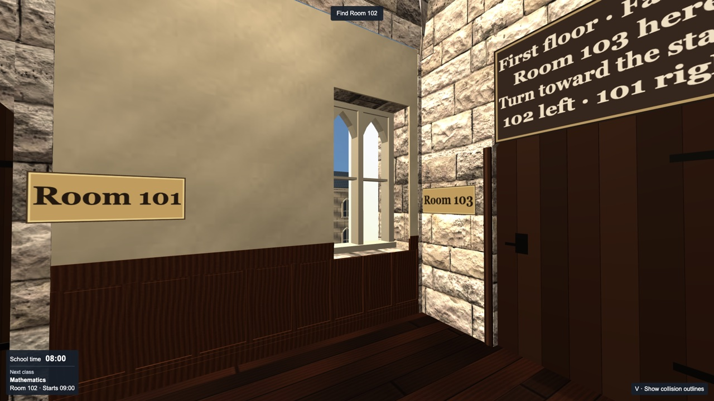
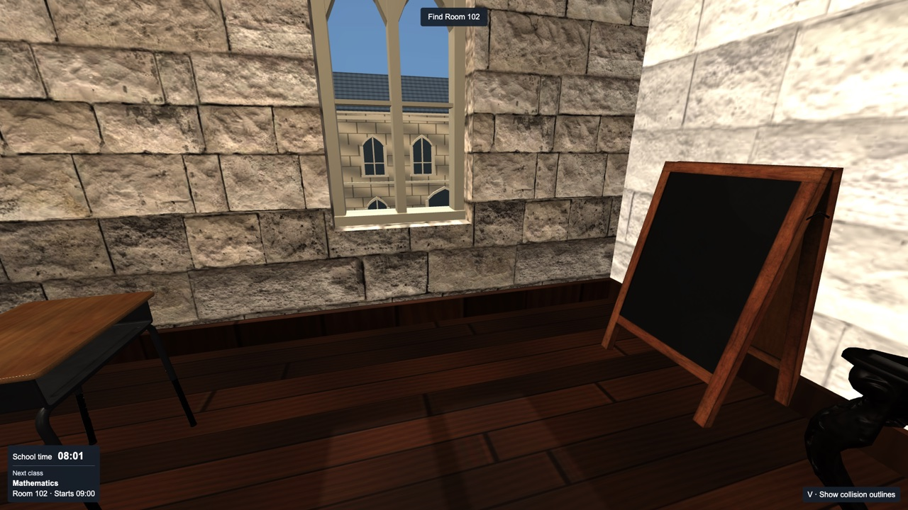

# Courtyard and daylight review

Open **Corridor and Classroom** at `/?level=3`. In the vaulted hall, walk past Room 101 to the window near Room 103. The second view is inside Room 101, across from its entrance. Mathematics is scheduled in Room 102, which makes both views available during the same attempt.

## First-person views

Both windows look east onto the same quadrangle. The opposite gateway and chimney help identify the same location from the corridor and Room 101. As in the New College reference, a rectangle of grass sits inside paved walks and a rhythm of stone bays. The window frames use the paired pointed lights and pale stone of the Divinity School reference. [Corridor courtyard view](references/courtyard-windows/corridor-court.jpg) · [Classroom courtyard view](references/courtyard-windows/classroom-court.jpg) · [Approved references](historic-school-reference.md#reference-sheet)

Each window has a deep masonry reveal, a low sill, and clear glazing. Two local spotlights cast shadows through the mullions. A softer fill lights the exterior while the lanterns still supply the room’s warm light. The glazing blocks movement across the opening and has its own outline in V view. [Full classroom window](references/courtyard-windows/classroom-window.jpg) · [Corridor window and reveal](references/courtyard-windows/corridor-window.jpg) · [Corridor floor in daylight](references/courtyard-windows/corridor-daylight.jpg) · [V collision view](references/courtyard-windows/corridor-window-collision.jpg)

## Verification and performance

All 100 Node and 76 Chrome tests passed. The window regression jumps into both reveals and checks that the player stops at the pane. Chrome rays crossed each pane and hit the opposite range. A framebuffer check verified that switching each daylight light off changed the indoor lighting. Three timed runs visited Rooms 003 and 101 and finished in Room 102. The browser also checked both glazing outlines in V after restart.

| Metric | Three-run verification | Approved ceiling |
| --- | ---: | ---: |
| Uncached startup resource bodies | 16,754,036 bytes (15.978 MiB) | 16 MiB |
| Time to enabled Start Game | 5.92 s median | 7 s median |
| 95th-percentile frame intervals | 8.9, 9.2, and 9.3 ms | 16.7 ms per run |
| Estimated decoded texture and geometry storage | 238.1 MiB | 256 MiB |

The runs used Chrome 158 at 1920×1080 on Apple M5 Pro graphics through ANGLE Metal. Startup used the agreed 25 Mbit/s bandwidth and 40 ms latency. The stone portal jambs now share the collegiate wall GLB and textures, freeing space for the courtyard. The facade uses light modeled surrounds and opaque window recesses. The quadrangle is an exterior vista viewed from inside the school. [Benchmark method](historic-school-reference.md#representative-route-and-browser-budgets) · [Kit data and build](historic-asset-kit.md#glazed-windows-and-courtyard-scenery)
