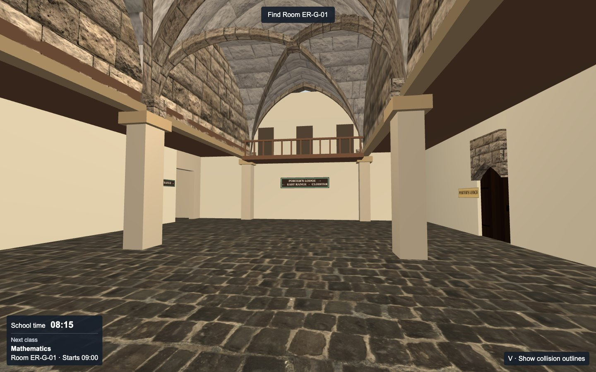
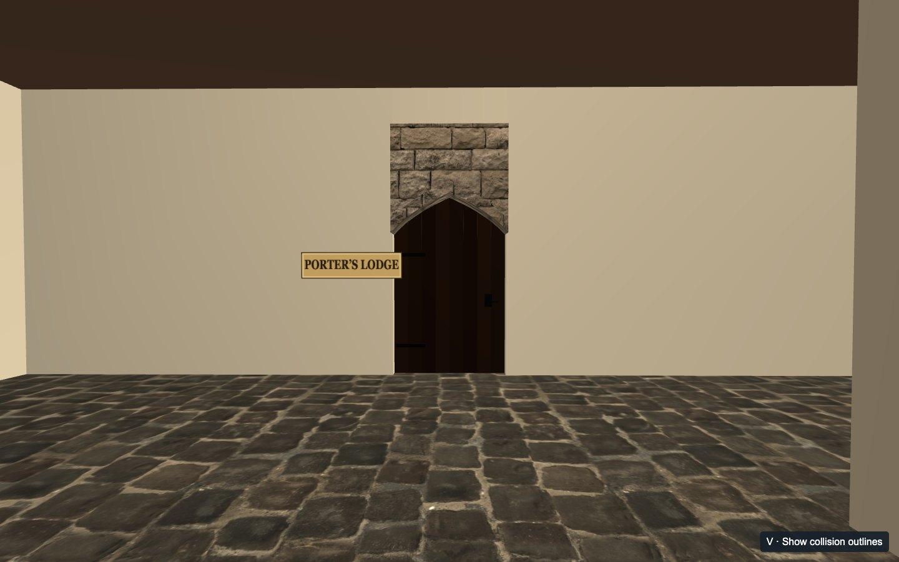
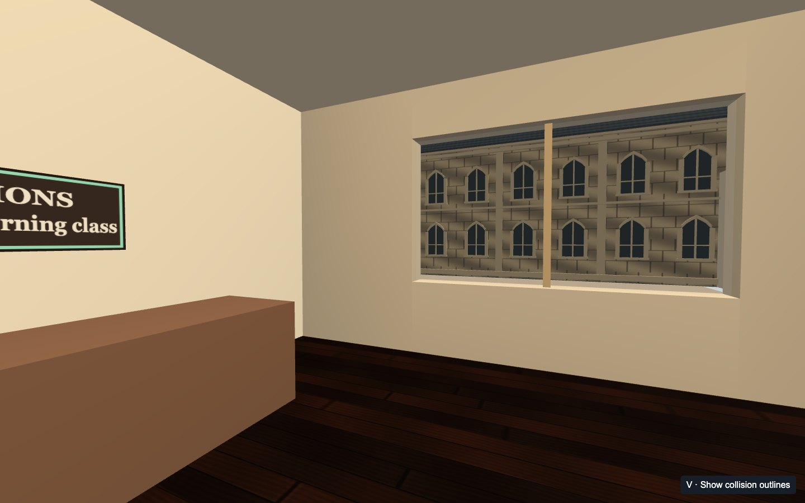
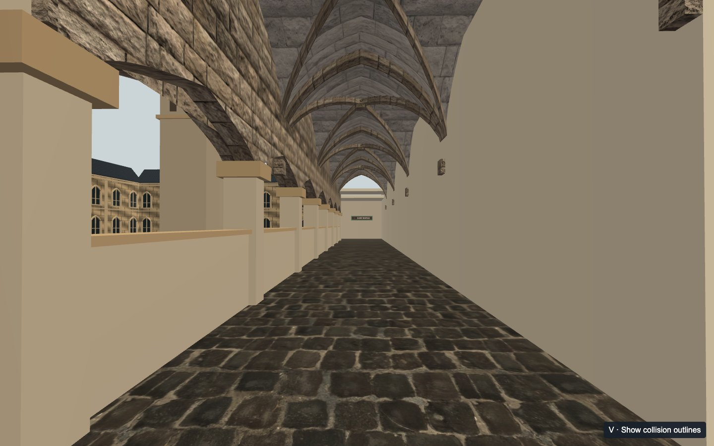
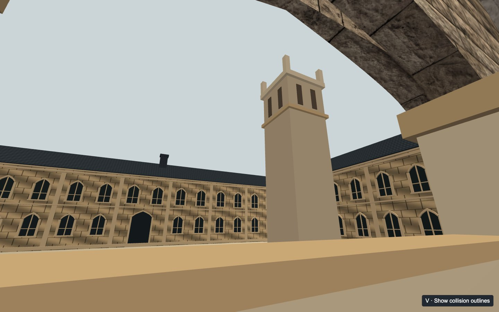
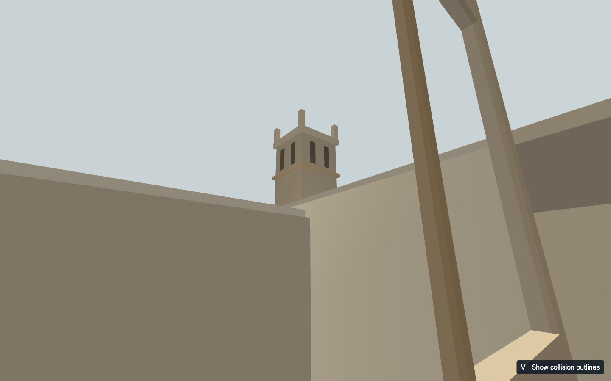
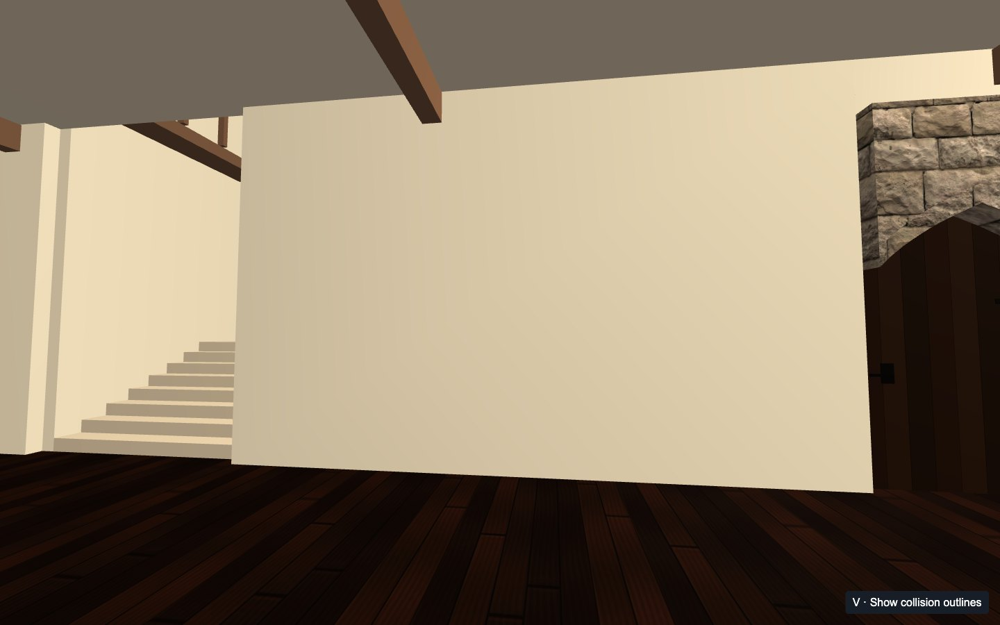
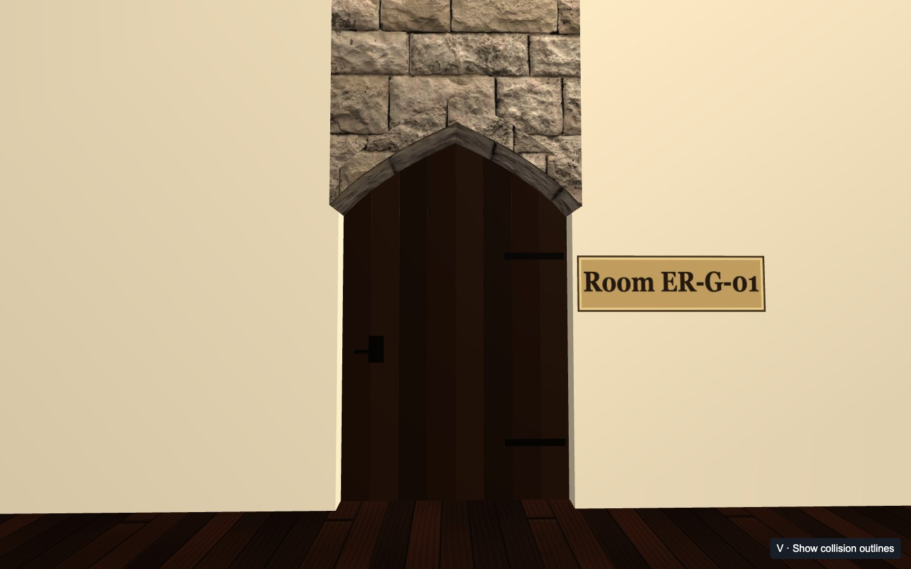

# First Court seven-room blockout review

**Start with the timed challenge.** Click Start Game and use the in-game timetable. After that run, use the development entry to inspect the same build at your own pace. All three areas stay loaded in both modes. [Play the timed challenge](http://localhost:8090/?level=4) · [Development exploration](http://localhost:8090/?level=4&mode=explore)

After your first run, record when you felt hurried, the clue that influenced your first turn, whether you recovered from a wrong turn, the time or place where the run ended, and a place you wanted to investigate. Then try returning by another route during untimed inspection. The opening allowance remains provisional pending that experience.

Verification and first-person screenshots for after the timed playtest

The revised build has seven numbered doors, five enterable rooms, two schedulable classrooms and a complete loop. Chrome reached the scheduled class at 08:30 via the cloister and 08:35 via Scholars’ Passage after entering the wrong classroom. In untimed mode the walkthrough visited all five rooms, checked both staff doors, climbed the lookout and returned to the lodge by the other arm with collision outlines enabled. These rehearsed times establish that both routes are physically viable. They do not measure first-time difficulty.

| Reception fork | Turn beyond the reading room |
| --- | --- |
|  |  |

| Cloakroom approach | Entry to East Range |
| --- | --- |
|  |  |

| Cloister overlook | Stair lookout |
| --- | --- |
|  |  |

**Cold startup.** At 1920 × 1080, DPR 1, 25 Mbit/s and 40 ms latency, three cold Chrome starts gave a median of 3.11 s for the entire new blockout. The 8,406,276 B of resource bodies include 7,506,936 B of GLBs. This puts the all-resident build 17,668 B over the 8 MiB target set for eventual A+B startup. Both teaching rooms share the desk and chair templates, so deferring area C alone should not be assumed to recover that margin. The original six-room prototype used 16,773,703–16,774,038 B and a median of 5.94 s. It remained under its 16 MiB and 7 s startup gates. These are startup measurements only.

## Earlier three-area blockout (historical evidence)

The images, times and counts below record the first layout before the seven-room revision.

**Milestone 20, geometry and sightlines.** Choose **The School — First Court** in the level picker. Try the scheduled class first to judge the decision at reception. The timer starts when you gain control. Afterwards use the untimed link to take the side trips. [Timed opening](http://localhost:8090/?level=4) · [Untimed development walk](http://localhost:8090/?level=4&mode=explore) · [Floor plan and acceptance criteria](milestone-20-new-school.md)

## Walk the school

The following 1440 × 900 captures are from Chrome at the player's normal eye height. All views are from reachable positions.

| At the gatehouse | At the west door |
| --- | --- |
|  |  |
| The board below the gallery points to the cloister and the lodge. | The door opens with **E**. The lodge is optional. |

| Inside the lodge | Along the cloister |
| --- | --- |
|  |  |
| The arrival yard has its own view from the waiting nook. | The route turns north, then east at the direction board. |

| Across the court | From the stair landing |
| --- | --- |
|  |  |
| The player can approach the parapet and look across the enclosed court. | Eight treads climb 1.44 m. The tower appears beyond the teaching wing from this second bearing. |

| The East Range junction | The classroom threshold |
| --- | --- |
|  |  |
| Take the stair for the view, or turn to the teaching room. | Open the door with **E** and walk fully inside to register arrival. |

## Play and regression evidence

- The Chrome walkthrough started with Mathematics displayed at 08:15, crossed both connections, opened ER-G-01 and arrived at 08:30. Play Again restored the starting area set. This was a rehearsed route. Its timing establishes feasibility. The 45 seconds of active time remain provisional pending an unfamiliar player's first attempt.
- In development mode the browser entered the lodge, looked across the court, entered the classroom and continued to the landing. It descended, walked back across both seams in collision view, revisited the lodge and returned to spawn. A Three.js ray from each overlook met the same tower shaft before any opaque obstruction.
- All 113 Node tests and 87 Chrome regressions passed. The new cases load the shipped geometry and check the graph, threshold headroom, jumping and reversal across the widths of both seams, doors, room detection, stairs, the court parapet and both tower views. The Node startup case covers the exact deadline, retry and untimed entry. [Test instructions](../tests/README.md)

## Cold startup at the blockout stage

Three fresh-cache navigations per school in desktop Chrome, 1920 × 1080, DPR 1, 25 Mbit/s and 40 ms latency. Resource bytes use the same Resource Timing encoded-body sum as milestone 19.5. The highest measured prototype sample leaves 4,996 B below its 16 MiB limit. [Milestone 19.5 baseline](connected-school-architecture.md#verification)

| School | Startup resource bodies | GLB bodies | Median Start enabled |
| --- | ---: | ---: | ---: |
| Six-classroom prototype | 16,771,885–16,772,220 B | 15,938,420 B | 5.95 s |
| First Court, all three areas resident | 1,764,600 B | 894,208 B | 0.89 s |

Compared with 19.5, the prototype downloaded 3,285–3,620 B more and made zero First Court manifest requests. First Court fetched one 36,927 B school manifest per start. Frame times during streaming, holds under delayed loads and ten-round-trip retained memory require the streaming stage.

## Layout decision

Does reception offer a tempting choice under time pressure, and does recognizing the tower from the landing help place East Range on the other side of the court? The blockout uses simple plaster walls, rough furniture shapes and a plain tower. The scale, decision points and sightlines are ready for review. All three areas stay resident for this review. Selective streaming, safe loading holds, final finishes, first-time player observation and the full performance review are later stages of milestone 20.
