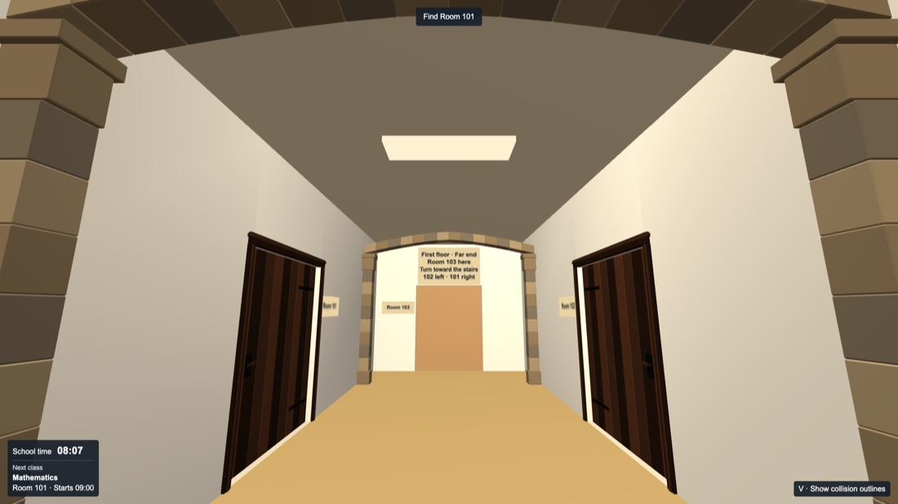
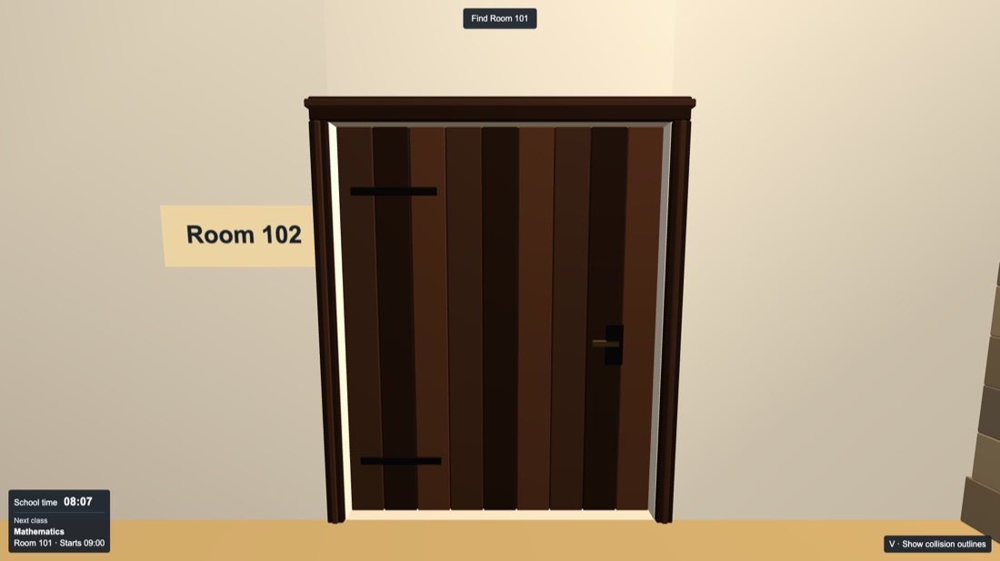
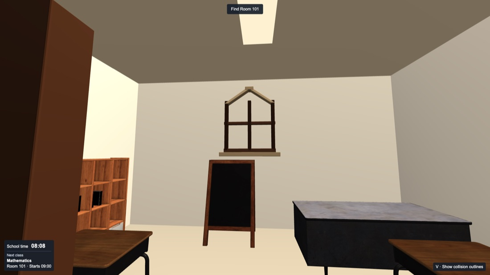
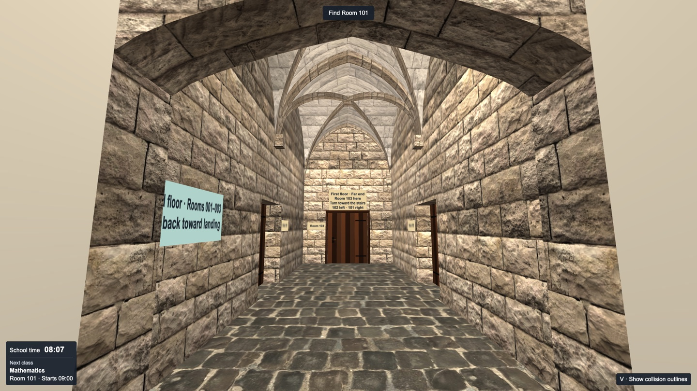
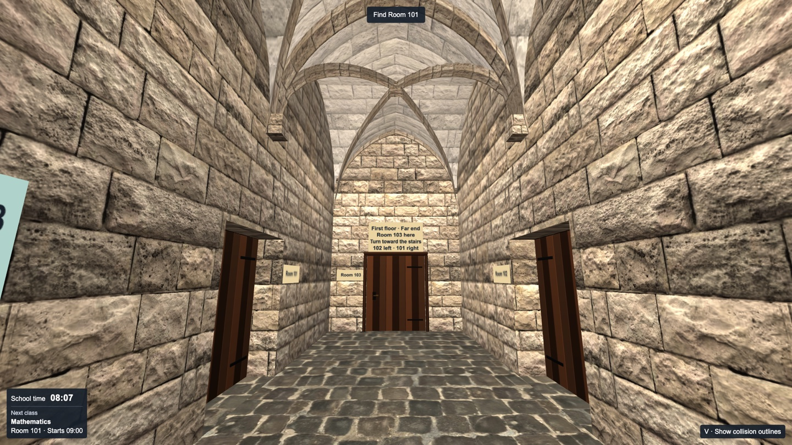
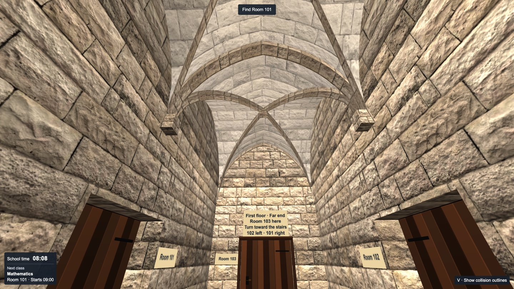
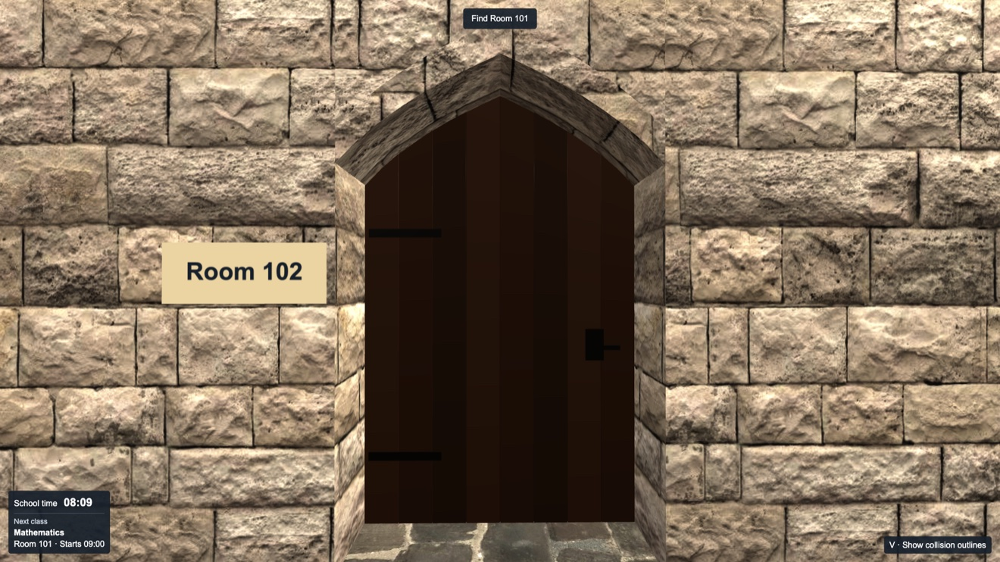
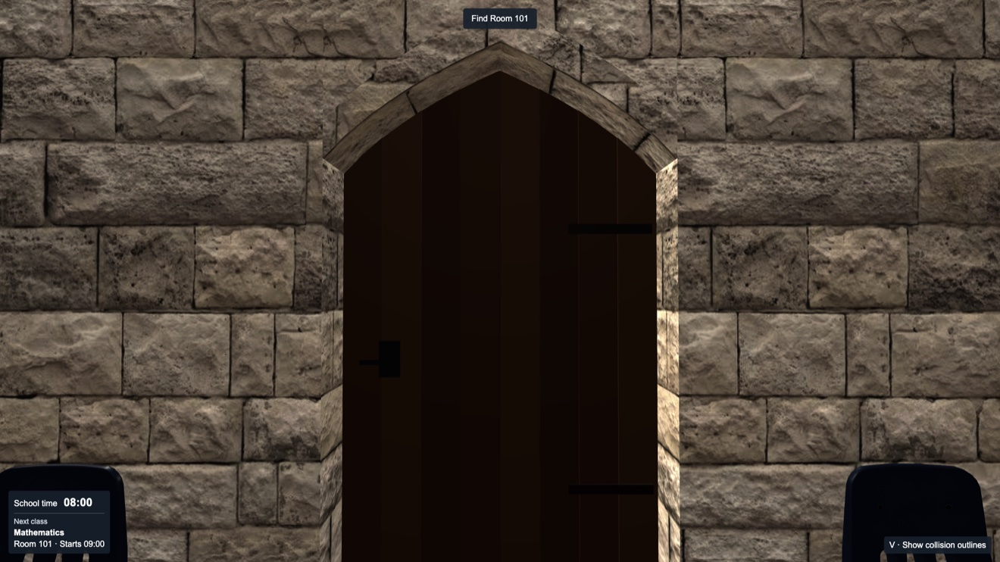

# Historic asset catalog and starter kit

## Audit of the existing implementation

The level already preloads each distinct explicit GLB path and shares the parsed template across placements and restarts. The factory preserves the authored materials, floor-aligns the loaded model, and fits a world-aligned collision box to each solid object. Level owns placement cleanup and draws those bounds in V view. Lighting, timed arrival, and the procedural furniture catalog already work independently of the model files.

The six runtime GLBs remain in use. Milestone 15 resized embedded textures offline and selected a row of books for the bookshelf. Level data currently repeats the GLB paths, and the chair faces correctly through placement-specific angles. The conversion commands and conventions were recorded only in development notes. The changes here add a reusable catalog and checked-in conversion instructions around the existing loader, collider, and restart behavior.

## Catalog and placement

The level's `modelCatalog` maps an `asset` name to a path relative to `assets/levels.json`. Its optional defaults are uniform `scale`, `rotationOffset` in degrees about Y, and `collidable`. Placements can override those fields or supply an explicit `model` path. Existing explicit model paths and procedural `type` placements are supported. Imported materials come from each GLB, so variant materials can be authored in a replacement model without changing scene placements.

```json
{
  "modelCatalog": {
    "studentChair": {
      "model": "models/runtime/lfc_student_chair.glb",
      "rotationOffset": -180
    }
  },
  "environmentObjects": [
    { "asset": "studentChair", "name": "Desk 1 chair", "x": 3.5, "z": 2.25, "rotationY": 180 }
  ]
}
```

Set the placement angle for the logical chair. The catalog applies the model's facing correction. The procedural chair still uses its own facing convention. Shared models are cached by resolved path, so furniture and architectural placements can share one template even if their placement transforms differ. A solid environment piece uses a world-aligned box around its transformed mesh, and V displays that box.

For a moving door, use an asset with the declared leaf width, height, and depth, centered on the horizontal origin and floor-aligned. The visual rides the existing door hinge and the existing door collider. Position the frame as separate jambs and a head. For an arch, use separate piers and a crown to keep the opening clear. The window frame samples are wall-backed and use fitted bounds. Real openings and an exterior view are covered by milestone 19.

## Wall and door mounting

Keep flat wall faces beside classroom entrances and visible at corridor and stair junctions. Current room signs get their text from classroom IDs, and directional signs use their existing level definitions and positions.

The existing catalog and level placements give fixed wall decorations a starting point. A placement can set its position and Y rotation to face the corridor and use `collidable: false` for a plaque, sign, or frame that sits flush against the wall. Future door-mounted objects should use coordinates local to the existing moving panel so they follow its hinge on both arched and rectangular doors. The panel already carries the door's visual model.

For a future painting trial, let level placements select a frame model and an image independently. Apply the image to a separate surface inside the frame so swapping it leaves the shared frame model and materials intact.

The milestone 18 sample applies `style: "brass"` to upstairs classroom signs and `style: "oak"` to selected directional signs. Both use the existing placement and canvas texture system. Classroom labels derive from the classroom ID. The oak boards use `backgroundColor` for the border so it can carry the floor accent. A sign with `notices` renders a college board with a title from `name` and a row of paper cards. Each card takes a heading and a caption from the level data. The framed portrait uses the existing model catalog, position, and Y rotation, with separate frame and canvas meshes in the GLB. [Collegiate corridor comparison](historic-slice.md#collegiate-corridor-review)

## Shared surface finishes

For a solid platform or wall, set `surfaceFinish` to an entry in the level's `surfaceFinishes` map. Each entry supplies a catalog `asset` and a `tileWidth` and `tileHeight` in world units. Use `materialName` when the source GLB has several materials. Without it, use a single-material asset. Box faces use world-aligned UVs so adjacent faces can share a tile without stretching it to each box's dimensions. Level owns and disposes those box geometries. The GLB cache retains the borrowed materials and textures through restart.

The original oak tile and lantern are generated locally with Blender. The lantern combines the iron parts into one mesh, shares its geometry across the stairwell and classroom, and uses separate level-defined lights. Its placement stays above the player's jump clearance.

```sh
blender --background --factory-startup --python-exit-code 1 --python scripts/build_historic_slice.py
```

## Collegiate bay wall module

Replace a solid wall segment with `collegiateBayWall` to add lime plaster above oak panels on the module’s negative-X face. Rotate the opposite wall 180 degrees around Y to face the interior. This preserves the original 0.8 × 3.9 × 4.1 wall envelope. The outer face and the ends remain stone. The wall module and the stairwell share its weathered masonry material. The oak floor uses the existing `oakBoards` finish, and the stair landing borrows its flagstone material from the existing doorway threshold model.

The Blender build uses the original procedural plaster and paneling and reads the portrait from `assets/models/architecture/textures/portrait_john_locke.jpg`. The canvas mesh has its own material so it can take a replacement image. [Portrait credit](historic-slice.md#collegiate-corridor-review)

```sh
blender --background --factory-startup --python-exit-code 1 --python scripts/build_collegiate_bay.py
```

## Glazed windows and courtyard scenery

Set a wall’s `windowOpening` to describe the rectangular cutout. `axis` is the wall normal (`x` or `z`). `center` measures along the wall in world coordinates, and `bottom` is the world Y height. `width` and `height` size the cutout. The same definition creates four collider sections around the opening. A platform wall renders those four sections directly. An imported wall uses its opening mesh with the same dimensions.

The collegiate GLB holds the `PlainBay`, `WindowBay`, and `PortalJamb` variants. Use `modelVariant` to select a named part from a catalog model. Variants share the file and its materials, and their local base sits at Y = 0. The offline build reads the corridor opening from level data and cuts the associated timber, plaster, and masonry meshes together. The two windows use the same sill and tracery GLB. A separate thin, translucent platform at each mullion plane supplies the blocking glazing collider. The frame casts shadows, so the glazing still lets daylight reach the room.

The court uses shared stone-range bays, one gateway variant, and a lawn, perimeter, and sky asset. The level positions each piece. `hideInDebug` hides the decorative vista and frames when V displays the opening’s collider sections. The exterior lights use the existing spotlights. [First-person courtyard review](courtyard-window-review.md)

```sh
blender --background --factory-startup --python-exit-code 1 --python scripts/build_collegiate_bay.py --python scripts/build_courtyard.py
```

## Offline assets and reproduction

Keep editable originals in `assets/models/` and game copies in `assets/models/runtime/`. The `lfc_student_chair.glb` and its other classroom peers use glTF Y up, with X and Z horizontal. Treat a world unit as approximately one metre, check the authored scale and horizontal pivot, and use a catalog rotation offset for a model whose authored forward direction differs. The loader aligns each model's lowest point with placement Y. Use lower texture resolution first on props viewed from a distance. The published game uses embedded JPEG/PNG, which work with the pinned Three.js r128 loader without extra decoders.

The repository includes the game-ready furniture GLBs and the architecture texture sources. To rebuild an optimized furniture model, use its matching full-size export from the local asset archive. The earlier desk and chair prototypes in `assets/models/` predate the current runtime models.

Rebuild the current student chair on macOS from the project root. Python 3 and `sips` are used offline. Write to a temporary location for the verification.

```sh
python3 scripts/optimize_glb.py assets/models/lfc_student_chair.glb /tmp/lfc_student_chair.glb
cmp /tmp/lfc_student_chair.glb assets/models/runtime/lfc_student_chair.glb
```

The script keeps mesh and material definitions and resizes embedded PNG/JPEG textures to a 1024-pixel maximum edge by default. It refuses an in-place conversion. The test machine reproduced the 2,701,332-byte chair exactly from its 71,289,776-byte original. A different operating system or image encoder revision may change binary output. Check texture dimensions and color, model scale, orientation, floor contact, and V outlines before switching a catalog entry. The shelf books are a curated subset of the original book layout.

Regenerate the starter architectural GLBs with Blender's offline Python. Blender is used for authoring only.

```sh
blender --background --factory-startup --python-exit-code 1 --python scripts/build_historic_kit.py
```

The original project-generated pieces are the limestone pier and crown, oak leaf and two frame pieces, and a mullioned window and sill. Their source is the Blender script. They use flat PBR material colors with zero texture maps. The [milestone 16 references and license register](historic-school-reference.md) inform the shapes and palette. The kit uses original geometry and materials. The downloaded candidates remain on the shortlist. A matched modular arch span, current door dimensions and hinge, and reusable wall-backed window samples could be authored as six small models within the route's existing space.

## Chrome verification

All 95 Node and 71 Chrome regression tests passed. The 1080p walkthrough entered Rooms 003 and 102 before winning in Room 101. Chrome also verified that the oak leaves share geometry, retain it across restart, and follow the existing panel and V outline.

| Measurement on the [milestone 16 reference device](historic-school-reference.md) | Result | Approved ceiling |
| --- | ---: | ---: |
| Startup resource bodies | 13.94 MiB total, including 0.18 MiB for the six new GLBs | 16 MiB |
| Cold startup at 25 Mbit/s and 40 ms latency | 5.23 s median, 5.18–5.25 s across three runs | 7 s median |
| Timed-route 1080p frame intervals | 8.3 ms median in each run. p95 was 9.1, 9.2, and 9.1 ms | 16.7 ms p95 per run |
| Estimated decoded texture and geometry storage | 218.4 MiB across the scene, with 54 textures | 256 MiB |

The memory estimate covers unique texture storage and geometry buffers. The new kit has no texture maps, and the six classroom models retain their existing texture sizes.

### Playable sample







[Room 102 in collision view](references/historic-kit/room-102-collision.jpg)

## Revised architectural sample

The upstairs hall now has two adjacent 5-unit rib-vault bays with a crown about 6.5 units above the floor. The 0.8-unit masonry walls form deep classroom reveals, and the pointed stair portal is built into the entrance gable. Floors and classroom thresholds share a worn flagstone finish. The furniture-free hall is the visual test.



The stair-to-hall transition uses the same contrast in height and scale as the Christ Church reference. Pale vault webs, transverse arches, and crossing ribs draw the eye up, following the Divinity School reference at a simpler scale. The ribs meet the masonry at the spring line.



The repeated bays, thick wall returns, and worn stone floor follow the New College cloister reference. The demonstration remains enclosed, so its light comes from level-defined interior sources. The room signs stay at their existing junctions, and the upstairs landing sign is mounted on the stair wall.



[Room 102 doorway and flagstone threshold](references/vaulted-hall/room-102-doorway.jpg) · [V collision view](references/vaulted-hall/hall-collision.jpg) · [Earlier starter-kit corridor](references/historic-kit/historic-corridor.jpg) · [Approved photographs](historic-school-reference.md#reference-sheet)

### Reuse, collisions, and sources

The hall is assembled from catalog entries in the level JSON. Both bays use the same vault and slab assets. Matching wall pieces, lintels, gables, portal jambs, end returns, and thresholds can be reused independently. The floor stays at world Y = 3 and the classroom door openings stay 1.8 units wide. Rooms 101 and 102 have doors recessed into the new wall thickness. They use their existing hinge, arrival rules, and collision dimensions.

The existing collision system fits boxes around the solid wall, floor, and portal components. Vaults and the entrance arch cap use conservative overhead boxes. Their lowest contacts are above the maximum jump height of the player's head. The open bays and doors keep the walking and jumping space clear in solid and V views.

The models were built with the existing offline Blender workflow. The source texture files are in `assets/models/architecture/textures/`. At build time, the script adjusts the palette and embeds diffuse maps up to 768 pixels across and normal maps up to 256 pixels across. The textures are CC0 by Rob Tuytel. [Sandstone Blocks 05](https://polyhaven.com/a/sandstone_blocks_05) · [Cobblestone Floor 02](https://polyhaven.com/a/cobblestone_floor_02) · [Poly Haven license](https://polyhaven.com/license)

```sh
blender --background --factory-startup --python-exit-code 1 --python scripts/build_vaulted_bays.py
```

### Revised Chrome verification

All 95 Node and 71 Chrome tests passed. Three 1080p timed runs went through Rooms 003 and 102 and finished in Room 101. The runs verified doors, stairs, fitted collision outlines, and GLB resource sharing across restart. The [same benchmark method](historic-school-reference.md#representative-route-and-browser-budgets) met all four approved limits.

| Metric | Revised hall | Approved ceiling |
| --- | ---: | ---: |
| Startup resource bodies | 15.16 MiB | 16 MiB |
| Cold startup at 25 Mbit/s and 40 ms latency | 5.62 s median | 7 s median |
| 1080p frame intervals | 9.0, 9.3, and 8.9 ms at the 95th percentile | 16.7 ms per run |
| Estimated texture and geometry storage | 237.9 MiB | 256 MiB |

The product owner accepted the revised hall and arched doorways as part of [milestone 17](../ROADMAP.md#17-asset-catalog-reproducible-model-pipeline-and-historic-architectural-kit) on 2026-11-24.

## Arched classroom doorways

Rooms 101–103 share a pointed oak leaf. The side-wall heads and end gable cut the same profile through their full masonry depth. The oak core reaches the profile and the plank faces sit just inside it, creating an even seam. The 1.8-unit opening keeps the old 2.25-unit spring-line clearance. The crown reaches 2.85 units. The smaller ground-floor rooms still use the rectangular door path.





[Open from the hall](references/arched-doors/arched-door-open.jpg) · [Open from the classroom](references/arched-doors/arched-door-from-inside-open.jpg) · [V collision view](references/arched-doors/arched-door-collision.jpg)

The level's `doorProfiles` defines the rise samples across the opening. The GLB authoring script uses that profile to build the masonry and leaf. In level data, a door selects it with `arch`, and the masonry selects it with `archOpening`. Match the declared width and spring-line height to the generated leaf and align the masonry head's placement with the spring line. Keep doors and their masonry on quarter-turn axes so the collision boxes fit the local opening.

A rectangular collider covers the base as before. Above the spring line, short box sections follow the crown and move with the leaf. The masonry uses complementary conservative sections around the opening. The V view shows these stepped bounds. E uses the existing hinge pose, and room arrival still uses the room's configured volume.

All 96 Node and 72 Chrome tests passed. Chrome checked 68 closed-seam rays from both sides of the Room 102 assembly and found no gaps in those samples. The walkthrough opened the leaf from either side, checked V view and shared geometry after restart, visited Room 102, and finished in Room 101. The three 1080p runs stayed within budget. Startup used 15.18 MiB, cold startup took 5.65 s at the median, the worst run had a 10.0 ms 95th-percentile frame interval, and estimated texture and geometry storage was 238.0 MiB.
