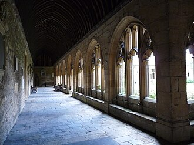
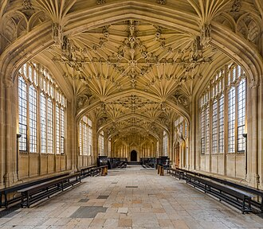
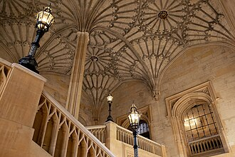
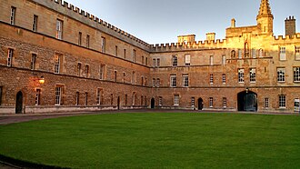

# Historic school visual reference and browser benchmark

**Milestone 16 · Approved by the product owner · 24 November 2026**

The historic school draws on Oxford collegiate buildings. Use pale, slightly warm masonry, dark oak, worn flagstones, and patches of daylight from deep window openings. Concentrate carving around an arch, window head, or landing so the rest of the building feels like an ordinary working school. Leave room numbers and stair directions clear at normal walking distance.

## Reference sheet

### Corridor · New College cloisters

Use the rhythm of repeating arches, the deep window reveals, and the worn flagstone joints. Keep most bays plain with an occasional carved stone. In the playable corridor, retain the current clear walking width and put signs on flat wall surfaces beside decisions and doors. Use subdued teal and ochre on existing signs as secondary floor cues while the floor numbers stay visible in text.

*Photo by Simon. Wikimedia thumbnail, resized from the source. [Source](https://commons.wikimedia.org/wiki/File:New_College_cloisters.jpg) · [CC BY 2.0](https://creativecommons.org/licenses/by/2.0/)*

### Classroom and windows · Divinity School, Bodleian Library

Use the pale stone, timber furniture, and tall windows at the scale of a modest teaching room. Set an oak plank door in a shallow pointed stone arch. Keep the teaching wall low in contrast behind the chalkboard and use worn oak boards for the classroom floor. Keep the current 1.8-unit clear door opening and 3.4-unit classroom height as the starting proportions. For a window prototype, try a deep sill around 0.9 units above the floor and a head around 2.9 units. A few narrow stone mullions should frame a clear view through the opening. Put strong window light on the side wall and floor so the teaching area and route out remain readable.

*Photo by David Iliff. Wikimedia thumbnail, resized from the source. [Source](https://commons.wikimedia.org/wiki/File:Divinity_School_Interior_1,_Bodleian_Library,_Oxford,_UK_-_Diliff.jpg) · [CC BY-SA 3.0](https://creativecommons.org/licenses/by-sa/3.0/)*

### Stairwell · Christ Church Grand Staircase

Use pale masonry, the silhouette of a low balustrade, and a pool of warm light to mark the landing. Keep edges of the existing twelve steps legible from above and below. Reserve the richest ceiling detail for a single landing. The stair passage should read as a public route as the player approaches it from Room 003.

*Photo by Jonas Magnus Lystad. Wikimedia thumbnail, resized from the source. [Source](https://commons.wikimedia.org/wiki/File:Christ_Church,_Oxford,_The_Grand_Staircase.jpg) · [CC0 1.0](https://creativecommons.org/publicdomain/zero/1.0/)*

### Exterior view · New College quadrangle

Frame a simple court from the interior window. Use a lawn, a paved edge, and an opposite range with repeated windows and one darker arch. Keep exterior detail strongest around that arch so the view has depth and a focal point. Courtyard geometry and daylight are planned in milestone 19.

*Photo by Joseph Bush. Wikimedia thumbnail, resized from the source. [Source](https://commons.wikimedia.org/wiki/File:New_College_quad.jpg) · [CC BY-SA 4.0](https://creativecommons.org/licenses/by-sa/4.0/)*

The photographs are reference material in this document. Their licenses are recorded with the captions. The prototype palette and route remain available as the baseline.

## Asset shortlist and provenance

Checked 24 November 2026. Use the local GLBs to establish classroom scale and material contrast. Evaluate one stone module, one door/frame, and one window component for the first kit. The external models were reviewed from their published previews and metadata. Their actual exports, texture sizes, scale, pivots, and fit in the renderer still need inspection in milestone 17.

| Candidate | Fit and disposition | License and credit |
| --- | --- | --- |
| Gothic Architectural Structures | Candidate stone arch and column kit. 7,890 triangles across the listing. Start with one repeated bay and compare its apparent stone scale with the cloister photo. | CC BY 4.0, Samuel F. Angrick-Johanns (Oneironauticus). [Model listing](https://sketchfab.com/3d-models/gothic-architectural-structures-affc5b590531447788aafc23a011154c) · [License metadata](https://api.sketchfab.com/v3/models/affc5b590531447788aafc23a011154c) |
| Medieval Gothic Style Door | Candidate timber door and frame. 23,802 triangles in the listing. The preview has two leaves and exterior steps. Try isolating and simplifying a moving leaf and frame while keeping the existing level threshold. The current data-driven door remains the interaction reference. | CC BY 4.0, Peter_268. [Model listing](https://sketchfab.com/3d-models/medieval-gothic-style-door-ba45230fd0fa4a6bad72caabf2644d84) · [License metadata](https://api.sketchfab.com/v3/models/ba45230fd0fa4a6bad72caabf2644d84) |
| Medieval window | Candidate window surround. The listing offers GLB and reports 1,380 triangles. The preview has two pointed lights and simple ironwork. Check that its bright panes can be separated from the surround to allow a courtyard view. | CC BY 4.0, ferrocreative. [Model listing](https://sketchfab.com/3d-models/medieval-window-1b326ec77cfe4798a7c82fbc35783213) · [License metadata](https://api.sketchfab.com/v3/models/1b326ec77cfe4798a7c82fbc35783213) |
| Sandstone Blocks 05 | Candidate masonry surface for the shared stone kit. Use a reduced-resolution diffuse and normal map in the first comparison. | CC0, Rob Tuytel. [Texture listing](https://polyhaven.com/a/sandstone_blocks_05) |
| Wood Planks | Candidate material for worn classroom flooring. Compare grain scale at walking height using the authored 1.5 m tile width. | CC0, Amal Kumar. [Texture listing](https://polyhaven.com/a/wood_planks) |
| Cobblestone Floor 02 | Candidate courtyard perimeter paving. Reserve it for the exterior view where the stone can read from a distance. | CC0, Rob Tuytel. [Texture listing](https://polyhaven.com/a/cobblestone_floor_02) |
| Six local classroom GLBs | Use the existing runtime copies as the scale and performance baseline. The owner identified the original student desk and chair as original work. The current replacements, teacher’s desk, shelf, chalkboard, and books have no per-file provenance or redistribution terms recorded in the repository. Record those details before redistributing the updated assets. | Project assets supplied by the owner. [Runtime model folder](../assets/models/runtime/) |

For any CC BY asset selected for the kit, carry the model title, creator, source, [license link](https://creativecommons.org/licenses/by/4.0/), and a note describing changes with the redistributed asset. CC0 material credits are retained here for traceability. [Poly Haven asset license](https://polyhaven.com/license)

## Representative route and browser budgets

Use the existing [Corridor and Classroom level](http://localhost:8090/?level=3) as the comparison scene. Set the benchmark schedule to Room 101 for this route. Begin at the ground-floor spawn, enter Room 003, follow the public stairs, visit furnished Room 102, then finish in scheduled Room 101. Capture eye-level views from the approach to Room 003, the foot of the stairs, and inside Room 102 facing both the teaching wall and suggested window location. Maintain these camera positions, draw resolution, and route when comparing the kit and later visual slice.

The initial test target is desktop Chrome with hardware-accelerated WebGL at 1920×1080 and device pixel ratio 1. The measured reference device used Apple M5 Pro graphics through ANGLE Metal and Chrome 158. These are the approved acceptance targets for this compact scene and device class.

| Metric | Existing scene | Approved target |
| --- | ---: | ---: |
| Uncached startup resource bodies, including code, level data, and GLBs | 13.75 MiB total, 13.00 MiB of GLBs | ≤16 MiB total |
| Navigation to enabled Start Game button, browser cache disabled, 25 Mbit/s and 40 ms added latency | 5.09–5.12 s across three runs | ≤7 s median across three runs |
| Animation-frame interval over the timed route with normal networking | 8.3 ms median, 9.2 ms p95 across 1,205 intervals | ≤16.7 ms p95 in each of three runs |
| Estimated decoded scene texture and geometry storage | 218.2 MiB, including 54 textures | ≤256 MiB |

Measure startup from the navigation time origin to the Start Game button becoming enabled. Sum the resource timeline’s `encodedBodySize` at that point. For the route, sample `requestAnimationFrame` from start to arrival and report the median and 95th percentile per run. Frame intervals include browser pacing and gameplay. Also record the browser, renderer, viewport, device pixel ratio, and the test network profile with each run.

Estimate memory by counting unique scene texture objects at four bytes per pixel with their mip levels, then adding unique backing buffers for geometry attributes and indices. This is an asset-storage estimate. Browser heap, driver allocations, and shadow or screen buffers require separate measurements. Keep the earlier per-render GPU readback results with milestones 13–15 as separate measurements.
