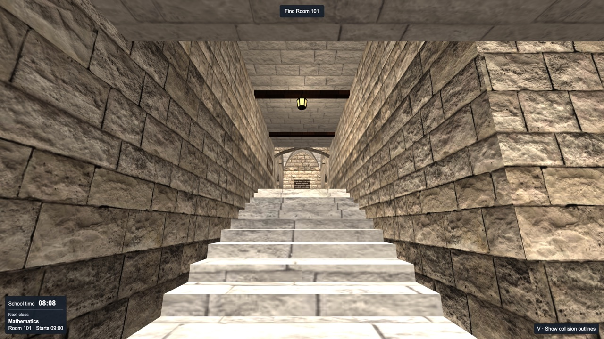
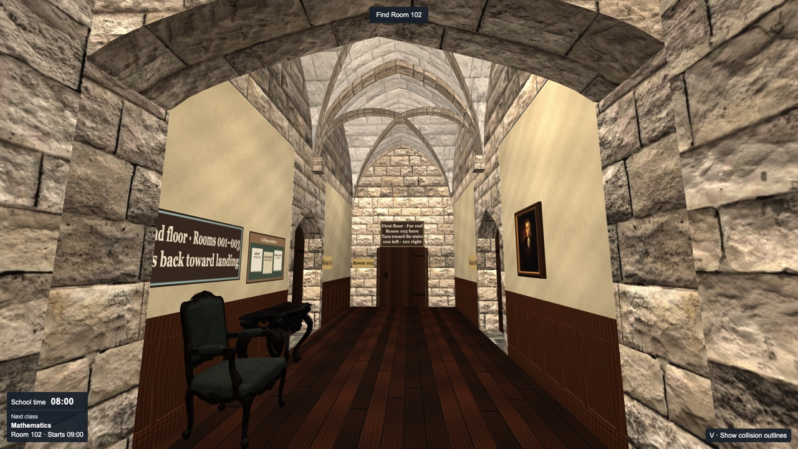
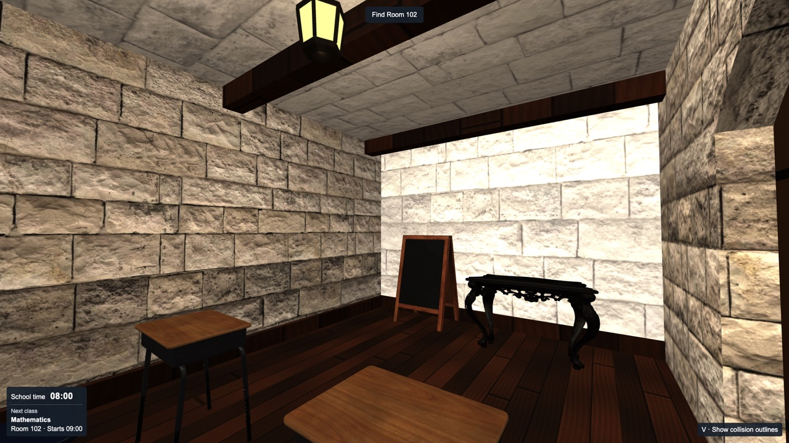
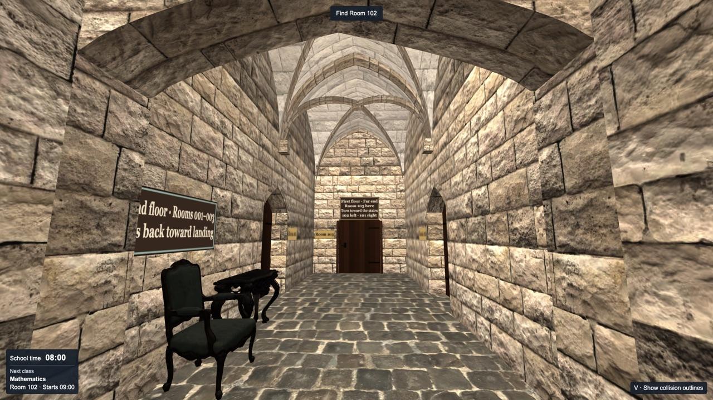
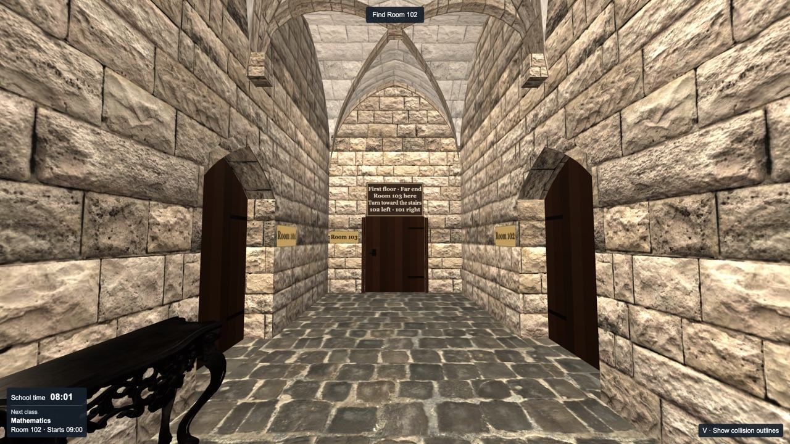
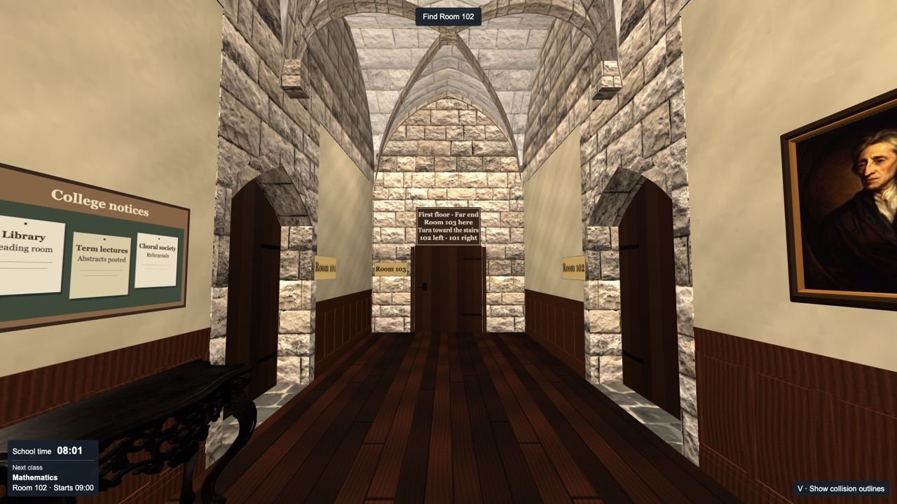

# Historic stair, corridor, and Room 101

Play **Corridor and Classroom** at `/?level=3`. Follow the public stairs, cross the vaulted hall, and press **E** at Room 101. The current schedule sends you to Room 102, so you can walk around Room 101 while the clock runs. Press **V** to compare the finished spaces with the collision outlines.

## First-person comparison

### Public stairs

The Christ Church reference uses pale stone and lanterns to draw the eye to the landing. The sample uses that same lighting cue and keeps all twelve treads. The pale tread tops and darker risers make the edges easier to pick out. Oak ceiling beams lead to the pointed stone portal at the landing. [Before](references/historic-slice/stairs-before.jpg) · [Christ Church reference](historic-school-reference.md#stairwell--christ-church-grand-staircase)

### Vaulted hall and wayfinding

The repeating arches follow the rhythm of the New College cloisters. Wooden wayfinding boards carry their existing directions, and the brass-style plaques take their text from the room IDs. Pale plaster and waist-high oak paneling now soften the two vaulted bays. [Collegiate corridor comparison](#collegiate-corridor-review) · [New College reference](historic-school-reference.md#corridor--new-college-cloisters)

### Room 101

The Divinity School reference pairs pale masonry with dark timber benches. Room 101 uses that material contrast at tutorial-room scale, with a limewashed teaching wall, oak floor and beams, a chalkboard, and two desks with student chairs. A path from the door stays clear between the desks and the teaching area. Room 101's wall-backed window sample was removed. The kit sample is still available in Room 102. [Before](references/historic-slice/room-101-before.jpg) · [Center aisle](references/historic-slice/room-101-center.jpg) · [View back to the doorway](references/historic-slice/room-101-return.jpg) · [V collision view](references/historic-slice/room-101-collision.jpg) · [Divinity School reference](historic-school-reference.md#classroom-and-windows--divinity-school-bodleian-library)

## Collegiate corridor review

The supplied reference photographs use pale plaster, timber paneling, and framed paintings at eye level. In the two game bays, aged lime plaster sits above low oak panels. The stone ribs, major arches, reveals, and thresholds mark the older fabric, while worn boards read as a later floor. A single portrait and a noticeboard with term notices sit opposite one another. The console and chair anchor the noticeboard side.

| View | Before | Revised |
| --- | --- | --- |
| From the landing |  |  |
| Inside the first bay |  |  |

[Framed portrait](references/collegiate-corridor/portrait.jpg) · [College noticeboard](references/collegiate-corridor/noticeboard.jpg) · [View back toward the stairs](references/collegiate-corridor/return-view.jpg) · [V collision view](references/collegiate-corridor/collision.jpg)

The framed image is Godfrey Kneller’s *Portrait of John Locke* (1697), from the Hermitage reproduction on Wikimedia Commons. The build resizes it to a 256-pixel texture inside the reusable oak and gilt frame. [Wikimedia Commons source and public-domain mark](https://commons.wikimedia.org/wiki/File:Godfrey_Kneller_-_Portrait_of_John_Locke_(Hermitage).jpg)

### Revised route verification

All 99 Node and 75 Chrome tests passed. Three timed runs visited Rooms 003 and 101 and finished in the scheduled Room 102. Chrome also checked the wall and floor outlines in **V** view after restart. The regression tests compare wall and floor dimensions and verify that the portrait and noticeboard add no colliders.

| Metric | Revised corridor | Approved budget |
| --- | ---: | ---: |
| Uncached startup resource bodies | 16,705,327 bytes (15.93 MiB) | ≤16 MiB |
| Time until Start Game is enabled | 5.90 s median | ≤7 s median |
| 95th-percentile frame intervals during the route | 8.9, 9.0, and 9.2 ms | ≤16.7 ms per run |
| Estimated decoded texture and geometry storage | 239.3 MiB | ≤256 MiB |

Chrome 158 ran at 1920×1080 on Apple M5 Pro graphics through ANGLE Metal. The oak boards reuse Room 101’s material, and the existing threshold supplies the flagstone texture for the stair landing. This cut the startup download by about 65 KiB compared with the first milestone 18 pass. [Approved benchmark method](historic-school-reference.md#representative-route-and-browser-budgets)

## First-pass verification and browser budgets

At the milestone 18 benchmark, all 98 Node and 74 Chrome tests passed. Three timed playthroughs entered Room 003, took the public stairs, and visited Room 102 before finishing in Room 101, which was scheduled for the benchmark. Chrome also checked the arched doorway seam, resource reuse on restart, and V view. The shared tests cover stair head clearance, the finished surfaces and their colliders, the room-ID label, and material reuse across level rebuilds.

| Metric | Three-run result | Approved budget |
| --- | ---: | ---: |
| Uncached startup resource bodies | 16,772,027 bytes (15.995 MiB) | ≤16 MiB |
| Time until Start Game is enabled | 5.94 s median | ≤7 s median |
| 95th-percentile frame intervals during the route | 10.0, 9.9, and 10.0 ms | ≤16.7 ms per run |
| Estimated decoded texture and geometry storage | 241.3 MiB | ≤256 MiB |

Chrome 158 used Apple M5 Pro graphics through ANGLE Metal at 1920×1080 and device pixel ratio 1. Startup measurements used a disabled cache, 25 Mbit/s, and 40 ms added latency. GLBs account for 15.226 MiB of the startup download. Sharing the existing models and textures leaves about 5 KiB beneath the startup ceiling. The new oak finish and lantern together account for 25.5 KiB. Asset storage excludes browser heap, driver memory, and render targets. [Approved benchmark method](historic-school-reference.md#representative-route-and-browser-budgets) · [Kit placement and asset build](historic-asset-kit.md#shared-surface-finishes)
