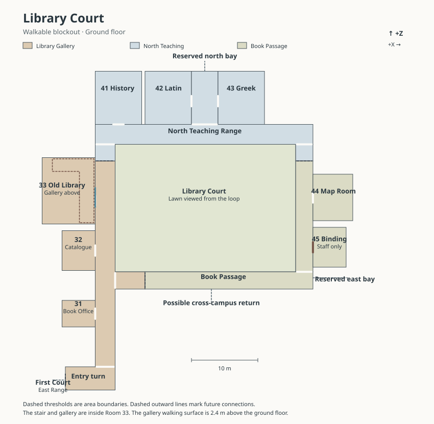

# Milestone 21 — Library Court and the North Teaching Range

**Status:** The owner approved Stage 1A as the navigation foundation. Stage 2 architectural identity and integration is implemented and awaits visual and gameplay review. Latin uses the configured 09:30–10:00 trial. [Stage 2 walkthrough, images and test results](#stage-2-as-built)

I propose adding **one mostly ground-floor district east and north of First Court**, entered through the end of East Range just beyond the Map Store. An older college library occupies the west side of a small enclosed court. A later teaching range closes its north side. A covered book passage runs around the other two sides, so someone carrying volumes between the library, classrooms and binding room can stay under cover.

That history gives the layout a reason to exist and gives the player a choice. On the first journey, the library is the easiest landmark to follow. On the return, the book passage is a useful way back to East Range. The proposed scope is **three new streaming areas, eight numbered rooms, three schedulable classrooms, one selectable new timed class, and an optional physically accessible library gallery**. The gallery belongs to Room 33; it is not a ninth numbered room or a new streaming area. All three existing First Court areas remain part of the same school. This follows the planning gate in the updated [roadmap](../ROADMAP.md#21-expand-the-connected-school--library-court-and-the-north-teaching-range) and [product vision](../VISION.md).

## Floor plan

North is up, east is right, and coordinates are approximate world metres `(X, Z)` with the walking surface at `Y = 0`. Lines show walkable routes. The court itself is visible through windows and the covered walk. Its lawn has no public entrance in this proposal; the optional *interior* library gallery provides the first physically accessible exploratory diversion. Dashed future routes are reservations, **not** current passages or doors.

```
                                  NORTH ↑
                       [future extension, not built]
                                    ⋮
                             North Schools lobby
                             42 Latin │ 43 Greek
                                      │
               41 History             T (63,72)
                    │                 │
      (48,72) NW ───┴─────────────────┴────────────── NE (78,72)
               │                                       │
    33 Old     ├── projecting library window            │ 44 Map Room
    Library    │   reachable interior upper gallery     ├── public collection
    + stair    │          LIBRARY COURT                 │
               │           enclosed lawn                │
    32         ├──                                      ├── 45 Binding Room
    Catalogue  │                                       │
      (48,50) SW ───── covered book passage ───────── SE (78,50)
               │             (future south route reserved, not built)
    31 Book    ├── issue counter and returns
    Office     │
               │ entrance northward
               └───── stone arch (42,35)
                                  │
                              First Court
        West Cloister ────── East Range ── beyond Rooms 25 and 26
                 ╲             ╱
                  Reception — Scholars’ Passage
```


The last two lines show the existing approaches schematically. **The proposed opening is in the solid `East Range end` wall at `(42,35)`**, straight ahead for someone walking east down the hall. Room 26 stays on the north wall at `(39.5,38)`, with its staff door and store volume intact. The new passage runs about 6 m east before turning north. It clears the store and keeps a player at Room 25 from seeing a whole new district down the corridor. This single aperture, its fitted finish and the directions needed to find it are the only proposed *functional* changes inside First Court. Cutting the existing solid end wall must preserve its remaining structural jambs/lintel, collision ownership and the fitted offline visual finish. The current finish builders include explicitly authored East Range wall paths: update or verify those together with the source wall and regenerate the affected GLB rather than leaving the old solid wall visually or physically across the new opening. Both original routes to Mathematics, the stair and its tower view retain their roles. [First Court school definition](../assets/schools/first-court.json) · [Existing layout](milestone-20-new-school.md)

The new loop measures about **30 × 22 m between passage centrelines**, or 104 m around. Allow roughly **48 × 55 m** for the district including rooms, entrance and north lobby. The library gallery and north range are about 3 m wide, the book passage about 2.6 m. The lobby widens to about 4 m so a player can turn, read both plaques and open either door. Ground-level circulation makes signs, route choice and recognition carry the difficulty.

## Rooms and public numbers

First Court already numbers rooms along historic approaches. A walk past the lodge leads through 12–15, while the cloister and East Range share 24–26 across an area boundary. Library Court extends that convention. **31–33 ascend from the Book Office toward the Old Library. 41–45 follow the teaching range from its library end, taking in the paired language rooms before turning down the east side.** Someone entering by the book passage encounters 45 first and can infer which way leads toward 42. The decades name local runs of rooms. All eight public room entrances are on the same ground floor; Room 33 alone has an optional internal upper gallery. [First Court numbering decision](milestone-20-new-school.md)

| Plaque | Room               | Approx. interior | Access and purpose                                                                                                           |
| ------ | ------------------ | ---------------- | ---------------------------------------------------------------------------------------------------------------------------- |
| 31     | Book Office        | 5 × 4 m          | Enterable public returns bay at the entrance. The counter gives the fork an immediately recognizable purpose.                |
| 32     | Catalogue Room     | 5 × 6 m          | Enterable reference room off the west gallery. A plausible first wrong turn for someone who follows “Library” too literally. |
| 33     | Old Library        | 8 × 10 m         | Enterable reading room and a short, **public stair to a small internal upper gallery**. A glimpse of the gallery and projecting window invites a detour; it offers a fresh view of the court but no mandatory clue or shortcut.                    |
| 41     | History Schoolroom | 7 × 8 m          | Schedulable classroom near the west end of the north range. Its plaque confirms the change to the 40s.                       |
| 42     | Latin Schoolroom   | 7 × 8 m          | Schedulable classroom on the west side of the north lobby. First expanded destination.                                       |
| 43     | Greek Schoolroom   | 7 × 8 m          | Schedulable classroom opposite Latin. Both entrances are visible from the lobby.                                             |
| 44     | Map Room           | 6 × 7 m          | Enterable teaching collection off the east walk. Distinct from the small staff Map Store in First Court.                     |
| 45     | Binding Room       | 5 × 6 m          | Staff workshop with a signed closed door. The public passage continues past it in both directions.                           |

Each room gets a school-wide stable ID and a separate public number. For example, the Latin schedule would target `north-latin`, with `42` resolved for the timetable and plaque. Its working door and arrival bounds belong to the same area. That preserves the existing ability to identify a destination before its meshes are resident. [School registry](../js/SchoolDefinition.js) · [Connected-school spatial contract](connected-school-architecture.md)

## Accessible discovery: the Old Library gallery

**Purpose:** The player should want to visit somewhere that is **not on the route to Latin**. Room 33 therefore includes a genuinely traversable, optional interior gallery. From the west walk, its open doorway or internal glazing reveals tall shelves, a small stair and a higher balustrade. Once inside, the player can climb one ordinary stair flight to an upper reading/viewing gallery and return by the same stairs. A view from the higher window links the Old Library to the court-facing window seen on the east walk.

- The gallery is **inside Room 33** and belongs to the Library Gallery streaming area. It has no separate public room number, no locked door, no key, no prize and no scheduled objective in milestone 21.
- The upper walking surface should sit at a plausible height (initial target approximately 2.2–2.6 m), with proper floor, stair, headroom, balustrade and collision. Exact placement requires a dimensioned blockout; use the existing `Player` stair/vertical collision system.
- Its entrance, route and upward view must actually be visible to a walking player. A decorative mezzanine that cannot be reached does **not** meet this requirement.
- The detour should consume meaningful seconds and tempt the player without being necessary for the short Latin trial. It should not disguise the correct direction or require a development-only teleport.
- Keep it development-quality, using existing furniture and historic materials. If the interior geometry cannot fit credibly within the proposed 8 × 10 m footprint, adjust the footprint and courtyard setback **at the planning/blockout gate**, rather than silently shrinking the room or dropping the experience.

The next district may contain other incidental curiosities, but this is the only exploratory showpiece required now. Further furnishings in **Scholars’ Passage** remain deferred visual debt under milestone 20; this expansion must not turn into another open-ended corridor-decoration project.

## The first expanded class

**Latin · Room 42 · 10:00.** Start at the established reception position at **09:05**, giving **55 seconds of active play at 60×**. Offer Mathematics and Latin as independently selectable, **data-defined challenges on the same campus**—not as duplicate `level=4` school manifests or disconnected levels. Mathematics keeps its 08:15 start, 09:00 deadline and Room 25 destination. Starting both journeys at reception lets knowledge earned in the first class pay off in the second.

**Small required software change:** Today `Game.init` reads one `manifest.challenge`, and `schoolFromManifest` validates that one scheduled destination. For this trial, define a small named challenge collection or equivalent configuration with **Mathematics as the unchanged default** and **Latin as an explicit opt-in** (for example, `?level=4&challenge=latin`). Resolve the selected challenge *before* session creation and validate its destination against the unchanged school-wide room registry. Invalid names must fail safely or choose a clearly documented default. Keep `?level=4` for the established Mathematics opening and `?level=4&mode=explore` for developer exploration; no automatic class progression, saved state or separate world copy. Scope and tests for this selector belong to milestone 21's playable-blockout stage.

| Decision               | What the player can see and infer                                                                                                                                                                                                                                                                                |
| ---------------------- | ---------------------------------------------------------------------------------------------------------------------------------------------------------------------------------------------------------------------------------------------------------------------------------------------------------------- |
| **Reception**          | Add *Library Court via East Range* to the existing direction board. Someone who remembers the cloister and tower can use them immediately. Someone who chooses Scholars’ Passage can still follow its East Range sign and recover without retracing the whole passage.                                           |
| **Past Mathematics**   | A fingerboard at the lookout stair reads *Library Court · Rooms 31–45* and points past 26. The new arch is visible beyond the Map Store. The familiar stair is a tempting diversion with a recognizable way back down.                                                                                           |
| **At the Book Office** | Straight ahead, *Old Library · North Schools 41–43*. Right, *Book Passage · 44–45*. The first is the shorter route to Latin. The second leads to real rooms and rejoins the teaching range. At 44, a return-facing sign points onward to *North Schools 41–43*.                                                  |
| **In the north range** | At the middle junction, a board over the recessed lobby reads *Language Schools · 42–43*, legible from either approach. Straight ahead continues around the court. Turning into the lobby reveals *42 Latin* and *43 Greek*. Only physically entering 42 through its open door before 10:00 completes the class. |

The proposed centrelines, not yet proven in a playable blockout, put the cloister–library route at roughly **170–180 m from spawn to the Latin threshold**. Taking the east side of Library Court adds about **30 m**, or five seconds at the configured 6 m/s. That gives a movement-only lower bound of roughly **29–30 seconds direct or 34–35 seconds around the east side**. The rest of the proposed 55 seconds pays for reading at several junctions, turning, opening the door and correcting a modest mistake. A player can afford to enter History, recognize 41 and move on. Someone who walks past the language lobby can keep going all the way back to First Court and lose the class on time. [Movement configuration](../assets/gameConfig.js) · [Existing timed-route evidence](first-court-blockout.md)

**55 seconds is a blockout hypothesis, not a locked difficulty target.** An unfamiliar player should attempt Latin timed first, without seeing this plan or using explore mode. Record the clue used at the Book Office, whether the language lobby was visible from their approach, the wrong turn and recovery, and time remaining or timeout location. If they miss the lobby because the board is invisible from the east, correct the sightline first. If they read the route correctly, make one short recovery and still routinely arrive late, revise the allowance. An unfamiliar player must not be expected to discover or use the optional library gallery to finish the class; it is a temptation, not a dependency.

## Architectural identity and reuse

| Area                     | Character and landmark                                                                                                                                                                                                                                 | Finish reuse                                                                                                                                                                                                                                                                         |
| ------------------------ | ------------------------------------------------------------------------------------------------------------------------------------------------------------------------------------------------------------------------------------------------------ | ------------------------------------------------------------------------------------------------------------------------------------------------------------------------------------------------------------------------------------------------------------------------------------ |
| **Library Gallery**      | A former private library range adapted for school use. A low stone entrance opens onto the issue counter, then a taller oak-lined gallery leads to the projecting reading-room window. The Old Library contains a **reachable internal upper gallery** and a real stair, visible enough to invite a detour. The same upper window is recognizable across the court on the return walk. | Use the approved limewash, recessed oak field and 1.065 m cap. Carry the profile continuously through the gallery and return it into the door reveals. A runner belongs on the dry gallery boards and ends at the stone thresholds. Reuse shelves, books, reading tables and chairs. |
| **North Teaching Range** | A later, more regular range. Broad plaster bays and repeated timber ties give the corridor a clear rhythm. The paired Latin and Greek doors share a deeper transverse opening that makes the lobby recognizable from either direction.                 | Reuse masonry heads, oak doors, brass plaques, boards, desks and chairs from the catalog. Fit the ties to whole bays. Put the strongest detail at the lobby junction and keep classroom dressing economical.                                                                         |
| **Book Passage**         | A workaday covered walk linking the teaching collection and bindery. Flagstones, plain limewashed masonry and repeated court-facing openings distinguish it from both the oak gallery and First Court’s vaulted cloister.                              | Reuse stone, threshold and lantern assets. Keep the damp-side paving bare. The return view of the library window supplies orientation without another tower or an additional landmark model.                                                                                         |

The expansion gives the approved finish pilot a concrete test. The Library Gallery needs the same wall-face lookup, oak profile and opening fit as Scholars’ Passage, over different wall runs. **At dressing time, a small neutral offline module is justified if the first gallery bay would otherwise duplicate those functions or its builder would need to import the Scholars’ Passage builder solely to obtain them.** Move only the demonstrated shared preset and helpers. Keep the library window junction, runner lengths, stone stops and tie spacing explicitly authored. Verify the extraction by rebuilding the two pilot GLBs byte-identically and by moving a new gallery opening in a temporary definition. The walkable blockout needs no extraction. [Approved finish pilot](first-court-visual-spec.md#offline-finish-preset) · [Current preset and builders](../scripts/build_scholars_passage.py)

## Area boundaries, streaming and performance

The three-area split gives each pair **one shared aperture**, which the current manifest adapter supports. The library owns the entrance, west walk, court-facing library window and rooms 31–33. North Teaching owns the north walk, lobby and rooms 41–43. Book Passage owns the south and east walks, court ground and rooms 44–45. [Connection validation](../js/SchoolDefinition.js)

| Shared threshold                 | Approx. centre | Owner of aperture, reveal and threshold                                                                                  |
| -------------------------------- | -------------- | ------------------------------------------------------------------------------------------------------------------------ |
| East Range ↔ Library Gallery     | `(42,35)`      | East Range, including the cut through its end-wall panelling. Library Gallery begins with a flush slab on the east face. |
| Library Gallery ↔ North Teaching | `(48,68)`      | Library Gallery, at the stone return just before the northwest turn.                                                     |
| Library Gallery ↔ Book Passage   | `(54,50)`      | Library Gallery, at the sheltered opening east of the issue counter.                                                     |
| Book Passage ↔ North Teaching    | `(78,68)`      | Book Passage, at the last covered bay before the northeast turn.                                                         |

Keep **the existing manifest's initial active-area selection unchanged** for the original Mathematics challenge; do not unconditionally preload the new district at startup. Approach East Range as today, then request the library before the end arch comes into view. The three new areas may need to coexist at the court. In particular, the projecting library window must remain visible from the east walk, and the court ground must already be present when first seen from the library. Required regions must cover those views in both directions, including jumps and rapid reversals. The number of active areas and the exact prefetch distances should follow the approved walkable blockout. World already supports overlapping required regions and delayed retirement. Cached templates survive area unloading, so a low active-area count alone establishes little about memory. [World residency](../js/World.js) · [Asset lifetime decision](connected-school-architecture.md)

For the blockout and integration reviews, carry forward these **provisional performance targets** on the established 1080p Chrome profile:

| Measure              | Proposed target                                                                                                                                                                                                                   |
| -------------------- | --------------------------------------------------------------------------------------------------------------------------------------------------------------------------------------------------------------------------------- |
| Cold startup         | ≤8 MiB and median Start enabled ≤7 s at 25 Mbit/s, 40 ms latency. The finish-pass high sample left only **15,903 B** of startup headroom. Measure the expanded manifest separately and defer detailed district data if needed.    |
| First complete visit | ≤16 MiB transferred and ≤256 MiB estimated decoded assets, including unique templates retained after visiting every room.                                                                                                         |
| Traversal            | Route p95 frame interval ≤16.7 ms, maximum frame near activation ≤50 ms, zero visible missing areas or ordinary-play loading holds.                                                                                               |
| Repeat traversal     | Ten loops in alternating directions. Check retained assets after warm-up, lights, both door swings, collision across seams and retry. Inject a delayed or failed load and verify that the hold preserves position and class time. |

The [Stage 2 results](#stage-2-as-built) compare the finished district with the existing targets and the Stage 1A measurements. [Finish-pass benchmark](first-court-visual-spec.md#12-architectural-finish-consistency-pass)

## Future connectivity, not a chain of wings

One entrance from First Court is sufficient **for this milestone**, because Library Court has a complete internal loop and destinations on both sides. It would be a mistake, however, to assume that every future wing must extend from the far end of the previous one. Reserve three *different kinds* of connections in the plan:

1. **North extension:** the lobby beyond Rooms 42/43 can later lead into a larger North Schools or lecture range. Today it terminates with a normal, finished architectural bay, not a pretend working door.
2. **East extension:** the book passage near the binding room/Map Room can eventually join a service or academic route continuing east. Keep room thresholds and wall ownership compatible with cutting a later opening.
3. **Potential cross-campus return:** leave space south of the book passage (provisionally near the middle of the south walk, around `X ≈ 64, Z ≈ 50`) for a *later, separate route* towards another court or school ground that could connect back to a **different** part of First Court or another existing district. This is a corridor reservation and a future adjacency objective, **not** a guaranteed direct connection at these exact coordinates: survey the intervening buildings, existing First Court walls, room bounds and streaming regions before approving any aperture.

At least one future expansion should connect **two existing districts** to create another traversable loop, not merely append a dead-end branch. Preserve outward-facing scenery, setbacks and plausible wall bays so those choices remain possible. Do not model locked doors or traversable-looking passages that lead into unloaded/unbuilt space. The small Library Court grass court itself remains visible but not publicly enterable in milestone 21; playable grounds belong to a later milestone.

## Review gates and approval decision

1. **Design gate (this file):** approve or revise the geographic layout, eight room identities, optional Library gallery, one new entrance, reserved cross-campus connection options, first Latin trial and proposed area ownership. Coordinates remain approximate until a collision-ready blockout. **No code changes at this gate.**
2. **Playable blockout:** keep the existing First Court intact except for the approved East Range aperture and wayfinding. Implement three simple new areas, the full court loop, working classroom doors, readable plaques, a traversable library stair/gallery and a minimal Latin/Mathematics challenge selector. Verify the player's reachable routes, optional detour, no false dead ends and both independent timed classes. **Owner walks the timed route first, then exploration. Stop for approval before dressing or tuning streaming.**
3. **Stage 1A navigation:** add the book-carriers’ and candidates’ circuits and verify both directions with the owner.
4. **Stage 2 architectural identity and integration:** fit the district finishes, furnish decision points selectively and verify movement, visibility, load recovery and resource use. **Stop for visual and gameplay review.**
5. **Stage 3 final tuning:** use playtest evidence to choose the Latin difficulty profile and seek milestone acceptance.

**Outstanding validation:** First Court's unfamiliar-player timing test remains open. For Latin, compare measured novice behavior with the proposed 55-second allowance. Test from both sides of the library loop and include deliberate wrong turns; no automated route timing should be described as first-time fairness evidence. Carry forward any explicitly acknowledged legacy startup-budget exception without silently changing the benchmark.

**Recorded design decision:** The product owner approved the revised three-area Library Court concept, one East Range connection, eight-room program, accessible library gallery, three future connection reservations and a provisional 55-second Latin trial. Stage 1 subsequently implemented this design; its actual results and remaining questions follow.

## Stage 1 walkable blockout

Stage 1 was tested with Latin starting at 09:05 and due at 10:00. The current [Latin · Room 42](http://localhost:8090/?level=4&challenge=latin) build starts at 09:30. [Mathematics · Room 25](http://localhost:8090/?level=4) is the default, and unknown challenge names select that default. [Developer exploration](http://localhost:8090/?level=4&mode=explore) disables the timetable. The links use the local development server on port 8090.



The loop is 30 × 22 m along its centrelines. The existing East Range owns the fitted arch at `(42, 35)`. The passage floor starts at the seam, runs to `X = 48`, and turns toward the Book Office junction at `(48, 50)`. Room 33 has an 8 × 10 m footprint, a 12-tread stair and a gallery at `Y = 2.4 m`. The projecting bay and the high court window align across the west walk. The east walk also sees the existing First Court tower over the roofs.

| Seam or reservation | As built |
| --- | --- |
| East Range ↔ Library Gallery | East Range owns the fitted 1.8 m pointed opening. The library owns the floor beyond the join. |
| Library Gallery ↔ North Teaching | West walk at `Z = 68`, south of the northwest turn. |
| Library Gallery ↔ Book Passage | South walk at `X = 54`, east of the Book Office junction. |
| Book Passage ↔ North Teaching | East walk at `Z = 68`, south of the northeast turn. |
| Future connections | Glazed bays terminate the north lobby at `(63, 81.5)`, book passage at `(79.3, 50.35)`, and south walk at `(64, 48.7)`. The courtyard is visible from its perimeter. |

The three district definitions and both challenges share the First Court manifest. The original two areas still start first. During play, the Library Gallery prefetches from the approaches to East Range. The other two district areas overlap along the courtyard for sightlines. West Cloister owns the tower and East Range owns the adjacent roof on that skyline, so both stay resident in the applicable court regions. The blockout uses the existing area lifecycle and ordinary platform, door and sign data. The East Range interiors export was rebuilt to join the existing plaster and oak to the new aperture.

### First-person review

| Location | View |
| --- | --- |
| First Court connection | [East Range arch](references/library-court-blockout/east-range-opening.jpg) |
| First route choice | [Book Office fork](references/library-court-blockout/book-office-fork.jpg) |
| Old Library detour | [Stair glimpsed from the west walk](references/library-court-blockout/library-window-from-walk.jpg) · [Stair and gallery](references/library-court-blockout/library-stair.jpg) · [Upper view across the court](references/library-court-blockout/gallery-view.jpg) |
| Return landmark | [Projecting library window from the east walk](references/library-court-blockout/east-walk-landmark.jpg) |
| Latin approaches | [From the west](references/library-court-blockout/languages-west.jpg) · [From the east](references/library-court-blockout/languages-east.jpg) · [Language lobby](references/library-court-blockout/language-lobby.jpg) |
| Longer route | [Covered Book Passage](references/library-court-blockout/book-passage.jpg) |

### Verification

All **126 Node tests** and **98 shared Chrome tests** passed, as reported by Codex. [Test instructions](../tests/README.md)

In the desktop Chrome walkthrough, Mathematics arrived at **08:30**. Latin arrived at **09:33** by the west walk and **09:39** by Book Passage after entering the Map Room and recovering. The scripted west route is approximately 172 m from reception to inside Latin. The long route adds roughly 30 m before the detour. The trials used the normal movement, door and clock controls. The times show that both routes are viable. The 55-second allowance still needs an unfamiliar player's timed-first attempt.

The exploration walkthrough entered all seven public rooms in the extension, checked the staff door, climbed and descended the Old Library gallery, returned around the court and through East Range, observed all three district areas retire, and restarted at reception. The shared regression walked ten alternating loops, checked Latin's door swing after retirement, and compared retained templates, scene objects, colliders and light fixtures.

The Node boot test covered challenge fallback, the exact Latin deadline and retry. Chrome compared 30 standing- and jump-height renders at selected viewpoints against the full scene. All 30 matched with the blockout's residency rules.

### Measured performance

Chrome 158, ANGLE Metal on Apple M5 Pro, 1920 × 1080 at device pixel ratio 1. Four cache-disabled starts used 25 Mbit/s and 40 ms latency. The browser was unthrottled after Start enabled. Transfer counts encoded resource bodies including the HTML navigation. Decoded estimates count unique geometry buffers and texture images with mip levels across live objects and cached templates.

| Measure | Stage 1 result | Review target |
| --- | ---: | ---: |
| Cold startup transfer | 8,313,955–8,314,290 B | ≤8 MiB |
| Median Start enabled | 3.08 s | ≤7 s |
| First complete visit transfer | 8,313,955 B, all received at startup | ≤16 MiB |
| Largest sampled decoded asset total | 61.76 MiB in the gallery | ≤256 MiB |
| Active traversal p95 frame interval | 9.8–10.1 ms across four runs | ≤16.7 ms |
| Longest frame within 1 s of activation | 41.6 ms | ≤50 ms |
| Longest request to activation | 14.2 ms | Six-area blockout baseline |
| Holds during ordinary play | 0 | 0 |

The manifest contributed 112,981 B. At most five of the six areas were active in the measured routes. The gallery and post-retirement samples both retained 18 cached GLB templates. The detailed visibility and slow-load survey remains the streaming integration review gate.

### Product-owner response — 27 November 2026

The product owner played the Latin timed challenge and reached Room 42 in approximately **25–30 seconds**. The connected school felt larger, but the owner found Library Court **too ordinary and rational**: even at the opening stage the campus should be gloriously complicated by unnecessary passages, surprising reconnections and administratively correct but unhelpful signage. This feedback concerns *world character and navigation design*, not broken collision or rendering. It does not establish novice timing; the 55-second allowance remains provisional. The developer-quality visual blockout is acceptable until the navigation geometry is settled.

## Stage 1A — Unnecessarily Complicated Navigation

**Purpose:** Give the already playable Library Court district a distinctive, historically accumulated navigational character **before** dressing it. Preserve the straightforward Mathematics and Latin tasks while making the surrounding school genuinely hard to map. This is normal, physically consistent geometry—not supernatural displacement or a player-hostile random maze.

### The topology we want

The present district has one obvious perimeter loop (west gallery → north teaching range → east Book Passage → south return) and a gallery detour. It is a good technical test but much too logical. Introduce **at least two additional genuine route-choice cycles** in the same district. Each should have two or more separate access points, a physically walkable return, a distinct function/history, and enough extent that taking it feels like an actual decision rather than a three-metre bypass.

**Possible historical functions (design intentions, not predetermined coordinates):**

1. **The old catalogue or book-carriers' passage:** A formerly useful back route between two places in the library complex, perhaps doglegging around the service side of Rooms 31–33. Its path is plausible for books and staff but inefficient for a pupil rushing to Latin. It must not overwrite the library stair, original rooms or court-facing windows.
2. **The former North Schools approach / binding passage:** Another returning connection through the existing teaching or Book Passage geography, with a different architectural character (service dimensions, older threshold, an inconvenient turn). One direction might unexpectedly bring the player back near a landmark they thought they'd left behind.
3. **One deliberately long, entirely valid way to a known destination:** This may reuse the two additions. A stranger following the institution's historically preferred route can take markedly longer than a direct route, while both paths eventually reach the correct place.

Codex must **survey actual current wall/room bounds, collision, window positions, area ownership and sign locations before fixing coordinates**. Adapt the suggested passage roles to fit the implemented world; don't hollow out an occupied classroom, run across the grass court, conceal a streaming seam or move the existing eight room entrances to satisfy a prose sketch. If two meaningful loops cannot fit without significant changes, report the geometry conflict and stop for owner design review rather than producing token stubs.

### Wayfinding grammar — truthful, unnecessarily bureaucratic

At real junctions, include at least three clearly readable directional signs that make institutional sense but are not optimized for the shortest pupil route. Names can distinguish an **original entrance**, **current public entrance**, **South Passage**, **North Schools** or a historical library service route. Illustrative phrasing (only if provably true once built):

- `North Schools — via Old Library` (if that signed route reaches North Schools)
- `Old Library — Original Entrance` (if there is a distinct accessible historical entrance)
- `North Schools (South Approach)` (if the approach actually enters from the south)
- `Library Returns / Book Passage` (if that passage really serves both)

Do not use arbitrary false arrows, misleading room numbers, invented destinations or a sign that points through locked/staff-only space for the public. Do not label an ordinary short detour “original entrance” unless the building and signage make the claim credible. Keep direct-room plaques and at least one inferable route to Room 42 reliable. Historical awkwardness is the joke; the player shouldn't need a hidden designer map to decode it.

### Constraints from the current implementation

- Current streamed areas: gatehouse, west-cloister, east-range, library-gallery, north-teaching and book-passage. Preserve their IDs, the eight new numbered rooms, existing public/staff access and Maths/Latin challenge selection. Do not add new numbered rooms merely to make the floor plan denser.
- `SchoolDefinition.js` currently rejects a second `connections` entry between the same `from`/`to` pair. Prefer building each added cycle **inside the existing area that owns its geometry**, rather than introducing a second inter-area aperture or rewriting the streaming graph. Existing four Library Court seams and First Court connections remain authoritative.
- Preserve future glazed connection reservations at the north lobby, east passage and south walk. They must remain non-traversable for now.
- Keep the courtyards readable from windows, Room 33's accessible gallery/stair intact, the original First Court tower visible, and any established sightlines to unloaded areas correctly covered by residency rules.
- Use existing platform/wall/sign/door definitions, model cache and architecture patterns. No new framework or broad engine refactor. The immediate work is a **collision-correct, minimally surfaced navigation blockout**; detailed oak/plaster, portraits and furnishing follow at the next art review.
- Preserve the existing 55-second Latin trial until tested with an unfamiliar player. Do not artificially extend the direct route to raise difficulty. No keys, collectables, scripted teleportation, changing corridors, deliberately false signs or forced “wrong choice” mechanism.

### Stage 1A evidence and acceptance gate

1. **Plan:** Provide a before/after overhead route graph marking named junctions, entry points, existing area ownership and at least two *new* cycles beyond the original courtyard perimeter. Explain historical purposes and why a signed long route is technically correct.
2. **Playability:** In ordinary walking controls, traverse both new loops clockwise and counterclockwise; verify surprising returns and that none is merely a dead end. Test both Mathematics routes, Latin by a direct approach, Latin by the officially signed but longer approach, the Library gallery and a meaningful wrong-turn recovery.
3. **Timing:** Record actual timed-route lengths and measurements; don't assert that owner success or automated testing proves novice fairness. Keep default 55-second Latin pending a blind first-time test. A longer route may lead to a late result, provided that consequence is fair and the direct route remains adequately indicated.
4. **Integrity:** Run Node and Chrome tests, plus collision/debug view checks, door state across area retirement, restart, visibility comparisons, rapid reversals and loaded/unloaded viewpoint checks affected by the new geometry. Report cold-start byte delta, cumulative decoded assets, frame p95 and maximum, and ordinary-play holds against Stage 1.
5. **Review:** Capture first-person screenshots of every new decision point and each surprising rejoin, along with a plan annotated with the historic route names. Stop at this review gate **before** stream-specific tuning or detailed art. No automatic commit/push.

**Acceptance is by the product owner:** the player should find Latin without needing to decode the whole campus, but a few minutes of exploration should reveal that its routes were organized by centuries of institutional compromises, not by a rational game-level designer.


## Stage 1A report and owner difficulty finding — 27 November 2026

**Status:** The Stage 1A navigation work is reported implemented and playable; the owner approves moving forward on the denser layout after confirming the school feels larger. This records user-provided verification, not independently repeated local tests.

- **Book-carriers' passage:** passes behind the Catalogue Room, reaches the Old Library beside the stair, and reconnects to the west walk beneath the gallery.
- **Candidates' passage:** turns behind History and provides a second entrance to Latin. At the northwest junction, the North Schools and Latin Candidates signs point in opposite directions but both legitimately reach Room 42.
- **Recorded timed routes:** Latin direct 170.3 m, arriving 09:33 under the earlier 55-second schedule; historic passages 195.9 m, 09:37; Map Room recovery 206.4 m, 09:39. Mathematics via West Cloister / Scholars' Passage: 92.6 / 114.7 m, 08:30 / 08:34. These measured examples are *not* guaranteed shortest paths or unfamiliar-player timing.
- **Reported verification:** 128 Node and 100 Chrome tests passed, both added circuits traversed in both directions, four doors preserved after unloading/reloading, 64 pixel-identical residency comparisons, ~6,698 B cold-start increase, 9.2 ms p95 traversal, 41.6 ms maximum frame, zero ordinary-play loading holds.
- **Owner difficulty experiment:** Latin class remains at 10:00; by changing the Latin clock start to **09:30**, the owner tested a **30-second deadline**, found it difficult but possible, and **enjoyed retrying**. This is valuable repeat-player evidence, not a blind novice assessment. Leave deadline *data-defined* and separately decide novice/familiar difficulty and any hinting.

**Design decision:** Accept the two new historic routes as the Stage 2 geographical foundation. No further corridor multiplication before visual and integration review. The school should retain abundant tempting unused routes, truthful but inconvenient signs and learnable shortcuts. Unlimited, fast retries and tight deadlines are part of the product vision.

## Stage 2 — Architectural identity and integration

**Goal:** Replace the current generic blockout look with believable, distinct architectural identities without changing geography or gameplay. Make it possible to recognize where you are by **what the building looks like**, not only the numbered plaques.

1. **Library Gallery and Old Library:** warmer old timber, scholarly books, modest furnishing, purposeful detail at the gallery/stair landing, coherent arches and texture transitions. Retain the temptation to explore upstairs.
2. **North Teaching Range and language lobby:** later, plainer, maintained academic finish that still has coherent plaster, wall trim and classroom cues; clearly distinguish the two Latin entrances.
3. **Book Passage and book-carriers' passage:** a utilitarian covered route and a narrower historic book-service passage, visually legible as different types of circulation. Use wall treatment, floor wear, signs, ceiling rhythm and restrained clutter to make the bends memorable.
4. **Candidates' passage:** distinguish the formal historical approach from the ordinary classroom route with appropriate threshold, wall finish and authentic institutional signage. Preserve both truthful directions to Room 42.
5. **Courtyard and future glazed bays:** believable historic exterior/window views and unfinished-world reservations, but no new playable grounds or connections.
6. **Systematic consistency:** re-use approved wall/panelling/plaster assemblies and named-source geometry references where suitable. No sudden disappearance of finishes mid-run, accidental 800 mm liners in 360 mm walls, z-fighting, sky gaps or wall/ceiling seams. Keep intentionally different wings distinct. Extract neutral finishing utilities only if concrete reuse in this stage justifies it.

**No scope expansion:** no new numbered rooms, loops, impossible architecture, player hazards, progression engine, additional streaming areas, non-player characters, or broad asset imports. Defer extra Scholars' Passage free-standing furniture and portraits unless small reuse is possible without jeopardizing this stage.

**Evidence and review:** matched first-person screenshots at each main junction, both entrances to Latin, Old Library stair and gallery, both new historic passages and glazed reservations; verify timed Math/Latin and untimed tours, collision, visibility with area retirement, quick reverse crossings, doors, cache/decoded resource growth, start-byte budgets, p95/max frame and no ordinary-play holds. Stop for owner visual review before final timing/closure.


## Stage 2 as built

Play [timed Latin](http://localhost:8090/?level=4&challenge=latin), [timed Mathematics](http://localhost:8090/?level=4) or [untimed exploration](http://localhost:8090/?level=4&mode=explore). The ordinary route to Latin remains signed directly through the west walk and North Schools lobby. The current 30-second trial uses the owner’s 09:30 start and the existing 10:00 deadline.

| Place | As-built architectural treatment |
| --- | --- |
| Old Library and west walk | Limewash above recessed oak, worn boards under the gallery and fitted timber casings at the reading-room doors. Roof ties seat into the wall plates. The timber stair and open balustrade make the upper floor visible from the room. Two warm pendants light the reading table, shelves, books, rug and Locke portrait. The gallery has a chair, reference shelves and a short accession notice beside the view across the court. |
| North Teaching Range | Pale plaster, a sage dado, painted rails and a repeated ceiling grid mark the later schoolrooms. History, Latin and Greek share a measured furniture layout with clear aisles. Latin’s regular painted entrance has a fitted timber surround. Its former entrance has a stone surround and a separate examination notice. |
| Covered Book Passage | Open court-facing arches, piers, coping and a timber ceiling rhythm give the public walk a sheltered exterior character. The Bindery remains staff-only. The Map Room has a cabinet and a table for atlases. |
| Book-carriers’ and candidates’ passages | The carriers’ route has low beams, rough lime render, a worn masonry plinth and the returns schedule. The candidates’ route is more formal, with a dressed-stone dado, painted lintels and an examination register. Both use the existing turns and exits. |
| Courtyard and reservations | The library range and classroom block have low slate roofs, fitted window frames and stone eaves. A gravel border defines the lawn. The court still looks back to the First Court tower. The north, south and east reservations remain glazed and closed. |

The existing floor plan, room numbers, door apertures, gallery stairs and areas were checked against the approved Stage 1A manifest. The added furniture colliders sit inside rooms and outside the tested routes. The library, teaching and book-passage finishes are separate model variants in one district GLB, loaded through the existing approach to East Range and shared by all three areas. That GLB adds 852,080 bytes on first approach. The school reuses the existing optimized desks, chairs, shelves, books, portrait, lanterns, floor textures and rug pattern. The offline builder uses named wall faces and actual opening widths to fit the door and window linings. Shared profiles and materials now live in a neutral authoring module. Both Scholars’ Passage and First Court interiors rebuilt byte-identically. In an offline fitting check, both jambs followed a 120 mm move of the gallery window and the builder rejected an opening moved beyond its source wall. [Approved Stage 1A plan](references/library-court-navigation/before-after.svg) · [District builder](../scripts/build_library_court.py) · [Shared finishes](../scripts/architectural_finishes.py)

Rebuild the district asset with `blender --background --python-exit-code 1 --python scripts/build_library_court.py` from the repository root.

### Matched first-person views

Each pair uses the same world position, eye height and direction. Both builds show the same set of open doors.

| View | Stage 1A | Stage 2 |
| --- | --- | --- |
| East Range threshold | [Before](references/library-court-architecture/before/east-range-threshold.jpg) | [After](references/library-court-architecture/after/east-range-threshold.jpg) |
| Entry turn | [Before](references/library-court-architecture/before/entry-turn.jpg) | [After](references/library-court-architecture/after/entry-turn.jpg) |
| Book Office fork | [Before](references/library-court-architecture/before/book-office-fork.jpg) | [After](references/library-court-architecture/after/book-office-fork.jpg) |
| West walk | [Before](references/library-court-architecture/before/west-walk.jpg) | [After](references/library-court-architecture/after/west-walk.jpg) |
| Old Library court door | [Before](references/library-court-architecture/before/library-court-door.jpg) | [After](references/library-court-architecture/after/library-court-door.jpg) |
| Old Library reading floor | [Before](references/library-court-architecture/before/old-library.jpg) | [After](references/library-court-architecture/after/old-library.jpg) |
| Library stair | [Before](references/library-court-architecture/before/stair.jpg) | [After](references/library-court-architecture/after/stair.jpg) |
| Upper gallery | [Before](references/library-court-architecture/before/gallery.jpg) | [After](references/library-court-architecture/after/gallery.jpg) |
| Court from the gallery | [Before](references/library-court-architecture/before/gallery-overlook.jpg) | [After](references/library-court-architecture/after/gallery-overlook.jpg) |
| Northwest route fork | [Before](references/library-court-architecture/before/northwest-fork.jpg) | [After](references/library-court-architecture/after/northwest-fork.jpg) |
| North arcade and Language Schools turn | [Before](references/library-court-architecture/before/north-arcade.jpg) | [After](references/library-court-architecture/after/north-arcade.jpg) |
| Latin ordinary entrance | [Before](references/library-court-architecture/before/latin-main.jpg) | [After](references/library-court-architecture/after/latin-main.jpg) |
| Latin classroom | [Before](references/library-court-architecture/before/latin-classroom.jpg) | [After](references/library-court-architecture/after/latin-classroom.jpg) |
| Candidates’ turn | [Before](references/library-court-architecture/before/candidates-turn.jpg) | [After](references/library-court-architecture/after/candidates-turn.jpg) |
| Latin candidates’ entrance | [Before](references/library-court-architecture/before/candidates-door.jpg) | [After](references/library-court-architecture/after/candidates-door.jpg) |
| Candidates’ landing from Latin | [Before](references/library-court-architecture/before/candidates-rejoin.jpg) | [After](references/library-court-architecture/after/candidates-rejoin.jpg) |
| Carriers’ turn | [Before](references/library-court-architecture/before/carriers-turn.jpg) | [After](references/library-court-architecture/after/carriers-turn.jpg) |
| Carriers’ library entrance | [Before](references/library-court-architecture/before/carriers-door.jpg) | [After](references/library-court-architecture/after/carriers-door.jpg) |
| Carriers’ door from the library | [Before](references/library-court-architecture/before/carriers-rejoin.jpg) | [After](references/library-court-architecture/after/carriers-rejoin.jpg) |
| South Book Passage | [Before](references/library-court-architecture/before/south-walk.jpg) | [After](references/library-court-architecture/after/south-walk.jpg) |
| East Book Passage | [Before](references/library-court-architecture/before/east-walk.jpg) | [After](references/library-court-architecture/after/east-walk.jpg) |
| Northeast fork | [Before](references/library-court-architecture/before/northeast-fork.jpg) | [After](references/library-court-architecture/after/northeast-fork.jpg) |
| Southeast turn | [Before](references/library-court-architecture/before/southeast-turn.jpg) | [After](references/library-court-architecture/after/southeast-turn.jpg) |
| Courtyard looking west | [Before](references/library-court-architecture/before/courtyard.jpg) | [After](references/library-court-architecture/after/courtyard.jpg) |
| North glazed reservation | [Before](references/library-court-architecture/before/north-bay.jpg) | [After](references/library-court-architecture/after/north-bay.jpg) |
| South glazed reservation | [Before](references/library-court-architecture/before/south-bay.jpg) | [After](references/library-court-architecture/after/south-bay.jpg) |
| East glazed reservation | [Before](references/library-court-architecture/before/east-bay.jpg) | [After](references/library-court-architecture/after/east-bay.jpg) |

[Gallery collision view](references/library-court-architecture/after/gallery-collision.jpg)

### Play and integration verification

| Desktop Chrome journey | Result |
| --- | --- |
| Mathematics via West Cloister | Arrived at 08:30 |
| Mathematics via Scholars’ Passage | Arrived at 08:34 |
| Latin by the west walk and ordinary lobby entrance | Arrived at 09:58 with the benchmark network throttle active |
| Latin via both historic passages | Late at 10:00 under the configured 30-second trial |
| Latin via Book Passage and a Map Room detour | Late at 10:00 under the configured 30-second trial |
| Untimed exploration | Both directions of both historic circuits, both Latin doors, all seven public rooms, the staff lock and the gallery stair in both directions |

The exploration run retired all three district areas after returning west, then re-entered and recovered the independent swings of all four doors to the Old Library and Latin. Restart cleared those swings and returned the player to reception. The timed Latin retries reset to 09:30. Stage 3 will use owner and unfamiliar-player evidence to choose a Latin difficulty profile.

**129 Node and 101 Chrome regressions passed.** Shared coverage includes ten alternating district loops, rapid seam reversals, door and room identity checks, furniture collision, the climb to 2.4 m, and barriers at the court and all three future bays. The new regression checks that the two Latin liners fit the 1.55 m openings, the gallery deck matches the oak finish, and the three areas share a single model template. It also checks the fitted surfaces against collision view.

Chrome compared full-scene and normally resident renders at 34 viewpoints at standing and jumping height. All **68 pairs** matched pixel for pixel, including the gallery, courtyard, both historic circuits and the First Court approaches. A delayed HTTP 503 on the district GLB produced a loading hold and a retry prompt. Position and the Latin clock stayed fixed during the hold. Retry loaded the real model and resumed from the same time. [Test instructions](../tests/README.md)

### Performance against Stage 1A

Chrome 158 with ANGLE Metal on Apple M5 Pro at 1920 × 1080 and DPR 1. Six cache-disabled starts used 25 Mbit/s and 40 ms latency. The direct Latin run kept that throttle through arrival. The other walks ran unthrottled after Start enabled. Decoded estimates include unique geometry buffers and texture mip levels in the scene and cached templates.

| Measure | Stage 1A | Stage 2 | Review target |
| --- | ---: | ---: | ---: |
| Cold startup body bytes, including HTML | 8,320,653–8,320,988 B | 8,334,450–8,334,785 B | ≤8 MiB |
| Median Start enabled | 3.07 s | 3.08 s | ≤7 s |
| First complete exploration transfer | 8,320,653 B | 9,186,530 B | ≤16 MiB |
| Peak sampled decoded assets | 63.99 MiB | 72.30 MiB | ≤256 MiB |
| Traversal p95 across runs | 9.1–9.2 ms | 9.0–9.2 ms | ≤16.7 ms |
| Maximum active frame | 41.6 ms | 50.0 ms | — |
| Maximum frame within 1 s of activation | 41.6 ms | 50.0 ms | ≤50 ms |
| Longest measured request to activation | 14.8 ms | 26.1 ms unthrottled · 330.0 ms throttled | — |
| Maximum active areas / retained templates | 5 / 18 | 5 / 19 | — |
| Ordinary-play loading holds | 0 | 0 | 0 |

The peak startup increased by 13,797 B over Stage 1A, leaving 53,823 B under the 8 MiB target. All 19 templates remained cached after the district retired. The largest decoded estimate came from the east-walk sample. After retirement the exploration sample measured 62.96 MiB.

### Stage 2 streaming correction

At the entrance to Library Court's west walk, a player looking north could see sky through the missing North Teaching Range. Turning back in the language lobby could also reveal a missing part of East Range. The earlier 34-camera review compared settled scenes at selected viewpoints. It missed the approach to the corner and allowed prefetched areas to finish loading before comparing the images.

**Visibility.** At the north porch of West Cloister, the sightline through the East Range arch starts near the turn at Z = 32. The old Library Gallery request started at X = 7.5 along the next passage, and its guaranteed region started at X = 41.6. The library now prefetches on the cloister approach at Z = 24. The required regions cover the porch, East Range and its vestibule from Scholars’ Passage. Along East Range, North Teaching and Book Passage now prefetch separately at X = 36 and X = 39. Both are required before the player can look north from the entry turn. The return views retain the west skyline through the entry turn, the visible part of East Range from the language lobby and Book Passage from the candidates’ landing. A jump-height ray from the south porch also picked out the stair-well roof on the First Court skyline. West Cloister now owns that existing roof box and its collider at the original coordinates, including when the player uses the lookout stairs.

**Frame stalls.** Three.js r128 specializes its lighting shaders for the number of point lights in the scene. Attaching or retiring an area changed that number. On the first render with the new count, Chrome waited for linked WebGL programs. At the East Range activation, a single render took 49.8 ms. Seven calls to `getProgramInfoLog` took 38.8 ms in that render. The renderer-thread trace shows synchronous `GetProgramiv → WaitForCmd` calls while Chrome's GPU process serviced the command buffer. The same effect recurred at Library Court's west walk. The eleven fixed, finite-range, shadowless area lights now use the school's existing global lighting registration. Their positions, colours, intensities and falloff stay as authored. The renderer pays for a fixed set of sixteen point lights. Area geometry, signs, door instances and colliders still load and retire. Startup still activates the gatehouse and cloister only.

**Matched desktop traces.** Chrome 158, Apple M5 Pro, ANGLE Metal, 1920 × 1080, DPR 1, fresh browser profile and disabled HTTP cache for each run. Exploration used pointer lock and player movement. The ordinary run walked from reception to East Range, around the court, back through the vestibule until the district retired, then into the court again. The constrained pair used the same approach and return with a shorter court leg, Chrome's 4× CPU slowdown, 25 Mbit/s and 40 ms latency. Measurements span the whole walk, including frames on either side of activation and retirement.

| Measurement | Ordinary before | Ordinary after | Constrained before | Constrained after |
| --- | ---: | ---: | ---: | ---: |
| Cold Start enabled | 262 ms | 263 ms | 3,238 ms | 3,184 ms |
| First render before Start | 123.4 ms | 122.5 ms | 167.4 ms | 166.7 ms |
| Longest gap between Chrome frame presentations | 58.33 ms | **33.33 ms** | 75.00 ms | **41.67 ms** |
| Longest presentation gap on re-entry from the cross passage | 16.67 ms | 16.67 ms | 25.00 ms | 16.67 ms |
| Longest animation-frame interval | 50.1 ms | 9.5 ms | 75.0 ms | 33.2 ms |
| Animation-frame interval p95 | 9.1 ms | 9.2 ms | 9.2 ms | 9.2 ms |
| Longest call to render during traversal | 49.8 ms | 6.0 ms | 60.0 ms | 12.6 ms |
| Longest asynchronous asset preparation | 7.6 ms | 17.0 ms | 341.9 ms | 340.8 ms |
| Longest synchronous area build | 8.1 ms | 8.7 ms | 16.4 ms | 15.0 ms |
| Longest scene and lighting attachment | 0.2 ms | 0.2 ms | 0.9 ms | 0.7 ms |
| Longest unload | 2.6 ms | 2.7 ms | 4.1 ms | 4.3 ms |
| GPU-process program links during traversal | 33 | **0** | 33 | **0** |
| Ordinary passage holds | 0 | 0 | 0 | 0 |

Asset preparation includes the asynchronous fetch and parse. Level build and attachment are timed separately. WebGL instrumentation covered shader compilation/linking and status reads, texture uploads, mip generation, geometry buffer uploads and draw submission. No individual texture or geometry upload call exceeded 1 ms during these instrumented walks. The reported half-second single-frame freeze did not recur on this machine. The largest directly observed pre-fix presentation gap was 75 ms. Trace excerpts preserve Chrome's native event timestamps and include the first visits to East Range, Library Gallery and both court walks. They can be opened in Chrome DevTools Performance. [Ordinary before](references/library-court-streaming/before-activations.json.gz) · [ordinary after](references/library-court-streaming/after-activations.json.gz) · [constrained before](references/library-court-streaming/before-constrained-activations.json.gz) · [constrained after](references/library-court-streaming/after-constrained-activations.json.gz)

**Sightline survey.** The reference render assigned each opaque mesh its owning area's colour, opened doors and looked through glazing. Six camera directions at eye heights of 1.60 m and 2.55 m sampled walkable floors and room footprints. Each visible area's ID had to be guaranteed by its required region at that position, even if an optional area happened to be prefetched or retained. Before the fix, 91 of 549 sampled positions could see across that guarantee. The same survey found zero after the fix. A second survey with the opposite door swing, a finer grid and explicit stair and gallery samples found zero at 1,117 positions. The browser regression also compares shaded renders from seven exposed viewpoints using all six areas and using only the guaranteed set, across four headings and both heights.

The Node and Chrome suites passed **130 and 103 tests** respectively. The Chrome test also checks that dropping optional areas at a fixed view creates no additional shader program. A separate closed-door survey included the glazing itself. It found zero uncovered positions in 1,099 samples. A cold, deliberately delayed 2.5 s HTTP 503 at the Library Gallery request stopped forward movement at Z = 30.19 before the north porch sightline opened. The camera and Latin clock stayed fixed at 09:31 through the failure, retry and resume. Restart restored reception and 09:30.

The following 1440 × 900 first-person captures use the same eye position and direction in both builds. The player walked to each location in exploration mode. The differing-pixel counts compare each live framebuffer with all six areas at the same pose, before JPEG encoding, with a one-channel-level tolerance.

| View and direction | Before | After | Differing pixels, before → after |
| --- | --- | --- | ---: |
| West Cloister north porch, looking through East Range at (2.45, 34) | [Before](references/library-court-streaming/north-porch-before.jpg) | [After](references/library-court-streaming/north-porch-after.jpg) | 1,056 → 0 |
| Library Court west walk, looking north from (48, 37) | [Before](references/library-court-streaming/west-walk-before.jpg) | [After](references/library-court-streaming/west-walk-after.jpg) | 3,560 → 0 |
| Language lobby, looking southwest from (64.4, 77.5) | [Before](references/library-court-streaming/lobby-return-before.jpg) | [After](references/library-court-streaming/lobby-return-after.jpg) | 1,039 → 0 |

**Gameplay and retirement.** Desktop Chrome reached Mathematics at 08:30 via the cloister and 08:34 via Scholars’ Passage. Direct Latin reached Room 42 at 09:58 with the network throttle active. After desktop focus interrupted an optional detour, an isolated Chrome run completed the remaining checks. Both longer timed Latin routes reached the configured 10:00 deadline. Exploration completed both historic circuits in both directions, both Latin entrances, the gallery ascent and descent and the staff-door check. It peaked at five active areas, unloaded all three Library Court areas on retreat, retained 19 shared templates and restored all four tested door swings on return. Restart cleared the swings. The full exploration transfer was 9,186,138 B, including HTML.
